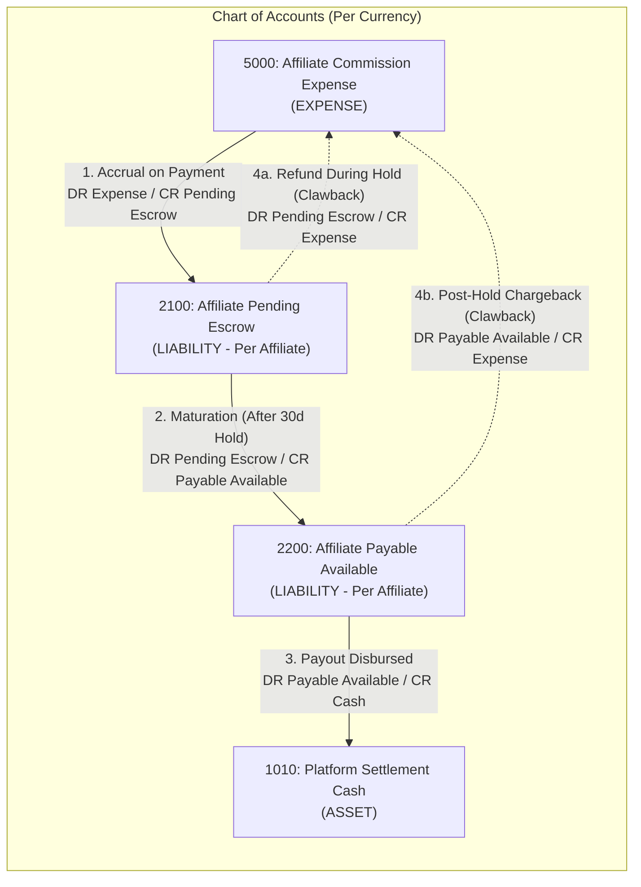

# Aura Platform — Affiliate Attribution, Configurable Commissions & Double-Entry Ledger Specification (`AFFILIATE_SPEC.md`)

---

## 1. Referral Links & Attribution Architecture

### 1.1 Link Format & Click Capture
- Partners generate campaign-tagged referral links: `https://www.auradating.com/r/{partner_code}?sub_id={campaign}` or `?ref={partner_code}`.
- When a prospective member visits with a referral code:
  1. The server validates that `partner_code` belongs to an `ACTIVE` affiliate.
  2. Records an anonymized click event and issues a signed first-party `aura_ref` cookie (`Max-Age: 2592000` / 30 days).
  3. **Privacy Rule**: Attribution tracking never records or exposes the referred user's sexual orientation, gender identity, or profile details to the affiliate partner. Partners see only aggregate click counts, anonymized conversion timestamps, subscription tier, and commission amounts.

### 1.2 Attribution Binding & Anti-Fraud
- At account registration (`POST /api/v1/auth/register`), if a valid `aura_ref` token or explicit referral code is present within the 30-day attribution window, an immutable row is written to `referral_attributions`.
- **Fraud Prevention**:
  - **Self-Referral Block**: Rejects attribution if the registrant shares an email domain, IP subnet, device fingerprint, or payment instrument with the affiliate.
  - **Trial-Only Exclusion**: Free trials (`$0.00`) do not accrue payable commissions until the first non-zero charge succeeds.

---

## 2. Configurable & Recurring Commission Rules Engine

Commission rules (`commission_rules`) are configurable per partner tier or custom contract without code changes:

| Rule Parameter | Description | Default Value |
| :--- | :--- | :--- |
| **`model`** | `CPA_FIXED`, `REVSHARE_PERCENT`, or `HYBRID` | `REVSHARE_PERCENT` |
| **`cpa_amount_cents`** | Fixed bounty paid on first verified paid conversion | `0` (or `$15.00` for CPA tier) |
| **`revshare_bps`** | Revenue share in basis points (`100 bps = 1.00%`) of Net Revenue | `2500` (`25.00%`) |
| **`recurring_enabled`** | Whether renewal charges generate recurring commissions | `true` |
| **`max_recurring_months`** | Maximum billing cycles eligible for recurring rev-share (`0 = lifetime`) | `12` months |
| **`escrow_hold_days`** | Days a commission remains in `PENDING_CLEARANCE` before payout eligibility | `30` days |

### Commission Formula
For billing cycle $k \ge 1$ of an attributed subscription with Net Revenue $N_{\text{cents}}$:
- If $k = 1$:
  $$C_1 = \text{CPA}_{\text{cents}} + \left\lfloor \frac{N_{\text{cents}} \times \text{revshare\_bps}}{10000} \right\rfloor$$
- If $k > 1$ and `recurring_enabled == true` and $(k \le \text{max\_recurring\_months} \text{ or } \text{max\_recurring\_months} == 0)$:
  $$C_k = \left\lfloor \frac{N_{\text{cents}} \times \text{revshare\_bps}}{10000} \right\rfloor$$
- Otherwise: $C_k = 0$.

---

## 3. Immutable Double-Entry Commission Ledger

All affiliate balances are derived from an **immutable, append-only double-entry accounting ledger** (`ledger_accounts`, `ledger_journals`, `ledger_entries`). Balances are never mutated via ad-hoc `UPDATE` statements without a balanced journal entry ($\sum \text{Debits} = \sum \text{Credits}$).

### 3.1 The Four Standard Journal Postings

1. **Commission Accrual (On Initial or Renewal Payment)**:
   - **Debit**: `5000: Affiliate Commission Expense` (`+C_k`)
   - **Credit**: `2100: Affiliate Pending Escrow ({affiliate_id})` (`+C_k`)
   - Sets `matures_at = occurred_at + escrow_hold_days`.

2. **Escrow Maturation (After 30-Day Hold With No Refund)**:
   - **Debit**: `2100: Affiliate Pending Escrow ({affiliate_id})` (`+C_k`)
   - **Credit**: `2200: Affiliate Payable Available ({affiliate_id})` (`+C_k`)

3. **Refund / Chargeback Reversal (Clawback)**:
   - If the commission has **not yet matured**:
     - **Debit**: `2100: Affiliate Pending Escrow ({affiliate_id})` (`+C_k`)
     - **Credit**: `5000: Affiliate Commission Expense` (`+C_k`)
   - If the commission has **already matured**:
     - **Debit**: `2200: Affiliate Payable Available ({affiliate_id})` (`+C_k`) (Can carry a negative balance offset against future earnings)
     - **Credit**: `5000: Affiliate Commission Expense` (`+C_k`)

4. **Partner Payout Settlement**:
   - Requires `tax_form_verified == true`, `affiliate.status == 'ACTIVE'`, and `available_balance_cents >= 5000` (`$50.00`).
   - **Debit**: `2200: Affiliate Payable Available ({affiliate_id})` (`+P`)
   - **Credit**: `1010: Platform Settlement Cash` (`+P`)
   - Dispatches transfer via Stripe Connect (`transfers.create`) with idempotency key `payout_{journal_id}`.

---

## 4. Implemented HTTP Endpoints & Router Mapping

### 4.1 Public & Referral Link Endpoints
- `GET /r/{partner_code}`: Public short-link redirector. Resolves campaign query parameters, records click event, sets 30-day `aura_ref` cookie, and returns `302 Found` redirecting to landing page.
- `POST /api/v1/affiliates/clicks`: Direct programmatic click tracking endpoint returning JSON payload with `click_token`, `affiliate_id`, and `destination_url`.

### 4.2 Authenticated Partner Endpoints (Requires Valid User JWT)
- `POST /api/v1/affiliates/register`: Onboards partner, enforces explicit terms of service acceptance, allocates unique `partner_code`, and initializes `TierStandard`.
- `GET /api/v1/affiliates/me`: Returns partner profile, tier, status, tax verification state, and double-entry ledger balance summary (`pending_escrow_cents`, `payable_available_cents`, `lifetime_paid_cents`).
- `PUT /api/v1/affiliates/payout-settings`: Updates payout method (`STRIPE_CONNECT` or `CRYPTO`), Stripe Connect account ID, or validated crypto wallet address/network/asset.
- `POST /api/v1/affiliates/campaigns`: Creates campaign tracking slug with custom destination landing URL.
- `GET /api/v1/affiliates/campaigns`: Lists campaigns owned by the affiliate.
- `GET /api/v1/affiliates/commissions`: Lists itemized commissions (`limit` capped).
- `GET /api/v1/affiliates/referrals`: Lists anonymized member referrals without sensitive attributes.
- `POST /api/v1/affiliates/payouts/request`: Submits payout withdrawal request enforcing tax form verification and minimum payout thresholds ($50.00 / 5000 cents).
- `GET /api/v1/affiliates/payouts`: Lists affiliate's payout history and current batch status.

### 4.3 Administrator RBAC Endpoints (Requires Admin Role)
- `GET /api/v1/admin/affiliates`: Lists all platform affiliates with pagination.
- `POST /api/v1/admin/affiliates/{id}/status`: Updates partner status (`ACTIVE`, `SUSPENDED`, `TERMINATED`), tier (`STANDARD`, `VIP`, `CPA_ONLY`), or sets `tax_form_verified`.
- `GET /api/v1/admin/affiliates/commission-rules`: Lists system-wide tier commission rules.
- `POST /api/v1/admin/affiliates/commission-rules`: Upserts custom commission rules with custom CPA bounty and rev-share basis points.
- `GET /api/v1/admin/affiliates/payouts/pending`: Lists pending payout batches requiring financial officer approval.
- `POST /api/v1/admin/affiliates/payouts/{id}/approve`: Approves and disburses payout batch via Stripe Connect or designated provider adapter.
- `POST /api/v1/admin/affiliates/escrow/mature`: Triggers scheduled release of matured escrow commissions into payable balances.

---

## 5. Database Schema & Migration Mapping (`000008_affiliate_ledger_and_payouts.up.sql`)

1. **`affiliates`**: Extended with `terms_accepted_at`, `terms_version`, `payout_method`, `crypto_wallet_address`, `crypto_asset`, `crypto_network`, `minimum_payout_cents`.
2. **`affiliate_campaigns`**: Stores sub-campaign tags (`campaign_slug`, `destination_url`, `is_active`).
3. **`referral_clicks`**: High-throughput click audit log storing anonymized IP hashes, user agents, referrers, and conversion flags.
4. **`referral_attributions`**: Immutable attribution link between referred user and affiliate with multi-touch candidate history and fraud flags.
5. **`commission_rules`**: Versioned commission formulas per tier (`CPA_FIXED`, `REVSHARE_PERCENT`, `HYBRID`).
6. **`affiliate_commissions`**: Accrual record linking billing transactions to affiliate commissions with `status` (`PENDING_CLEARANCE`, `AVAILABLE`, `PAID`, `CLAWED_BACK`), `matures_at`, and compensating refund tracking.
7. **`ledger_accounts`, `ledger_journals`, `ledger_entries`**: Balanced double-entry financial accounting records with immutable append-only constraints and debit/credit validation.
8. **`payout_batches`**: Multi-provider payout orchestration tracking provider transaction IDs, batch status (`PENDING_APPROVAL`, `PROCESSING`, `PAID`, `FAILED`), failure reasons, and timestamps.

---

## 6. Test Suite & Verification Summary

- `TestAffiliateRegistrationAndCampaigns`: Terms agreement enforcement, duplicate prevention, and campaign tracking.
- `TestReferralAttributionAndAntiFraud`: Anti-self-referral validation and multi-channel attribution.
- `TestCommissionCalculationAndLedgerIntegrity`: Integer basis-point commission math, VIP tier hybrid CPA+RevShare calculation, second-cycle recurring renewal rule, and idempotency deduplication.
- `TestRefundClawbackCompensatingReversal`: Double-entry reversing journal entry for transaction refunds during escrow hold.
- `TestEscrowMaturationAndPayoutSettlement`: Net-30 hold release worker, W-9/W-8BEN tax verification gate, Stripe Connect disbursement, and lifetime paid accrual.
- `TestCryptoPayoutValidationAndBoundary`: EVM & Solana wallet address format validation and disabled-by-default execution safety boundary.
- `TestBillingEventConsumerIntegration`: Real-time asynchronous processing of `billing.transaction_verified.v1` and `billing.transaction_refunded.v1`.
- `TestAffiliateHTTPHandlerAndRedirect`: Public `/r/{code}` HTTP 302 redirects with `aura_ref` cookie and authenticated REST partner endpoints.

