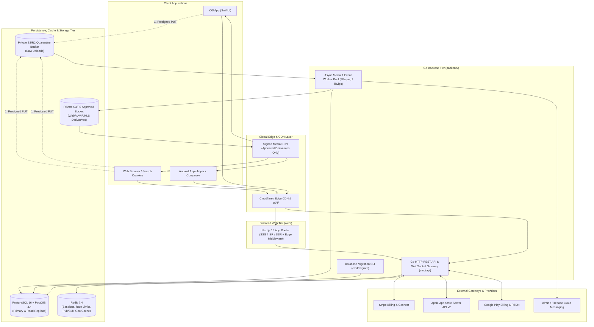
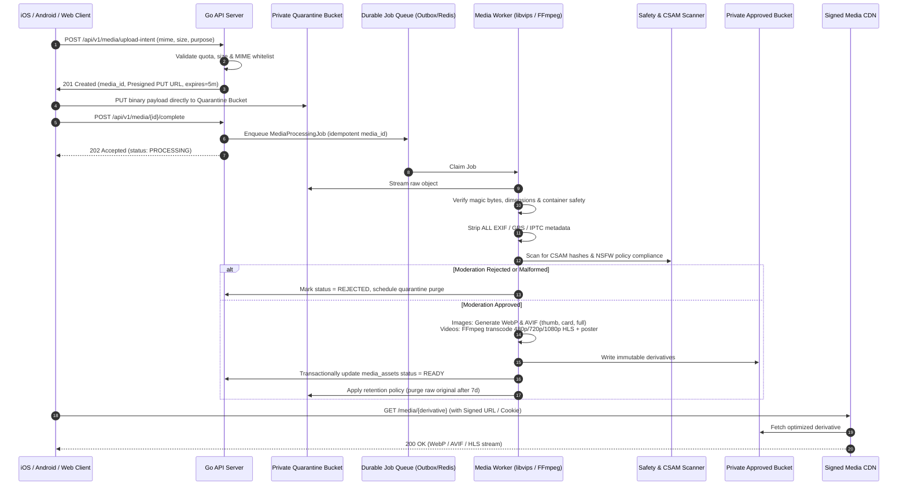
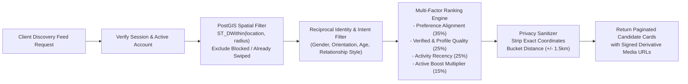

# Aura Platform — System & Software Architecture (`ARCHITECTURE.md`)

**Document Status**: Phase 01 Approved Blueprint  
**Related SEO Specifications**: See [`docs/architecture/`](file:///C:/Users/ACER/.gemini/antigravity/scratch/lgbtq-dating-platform/docs/architecture/phase-00-seo-architecture-and-implementation-plan.md) for detailed Consumer Web & Technical SEO specifications.

---

## 1. Architectural Philosophy: Modular Monolith with Explicit Domain Boundaries

Rather than creating dozens of empty microservice repositories that introduce distributed-transaction fragility and operational overhead before scale demands it, Aura is architected as a **Domain-Driven Modular Monolith in Go (`backend/`)** paired with the **Next.js 15 App Router Web Platform (`web/`)** and dedicated **Asynchronous Media Processing Workers**.

Each internal Go domain module (`identity`, `profile`, `discovery`, `matching`, `messaging`, `billing`, `affiliate`, `media`, `moderation`) owns its dedicated PostgreSQL tables, exposes strict Go interfaces, and communicates asynchronously across domains via the **Transactional Outbox & Event Bus (`internal/events`)**. Any module (such as the CPU-intensive `media` FFmpeg worker or `messaging` WebSocket gateway) can be scaled independently as a separate deployment target from the same unified codebase.

---

## 2. Overall System Architecture Diagram

---

## 3. Domain Module Ownership Matrix

| Domain Module | Go Package Path | Owned Database Tables | Core Responsibilities |
| :--- | :--- | :--- | :--- |
| **Identity & Auth** | `internal/identity` | `users`, `user_sessions`, `oauth_identities`, `otp_verifications`, `security_audit_logs` | Registration, Argon2id auth, JWT/refresh token rotation, MFA/OTP, device revocation, account deletion. |
| **Profiles & Preferences** | `internal/profile` | `profiles`, `profile_identities`, `dating_preferences`, `verifications` | LGBTQ+ gender/orientation/pronoun taxonomy, relationship intents, privacy visibility controls, selfie verification. |
| **Discovery & Geo** | `internal/discovery` | `profile_locations` (PostGIS), `discovery_boosts` | PostGIS `ST_DWithin` spatial queries, coordinate fuzzing, multi-stage compatibility ranking, Passport mode. |
| **Swipes & Matching** | `internal/matching` | `swipes`, `matches`, `entitlement_quotas`, `match_rewards` | Like/Pass/SuperSpark/Rewind processing, atomic mutual-match creation, daily quota enforcement, reward grants. |
| **Messaging & Chat** | `internal/messaging` | `conversations`, `messages`, `message_receipts`, `notification_outbox` | Real-time WebSocket fan-out (Redis Pub/Sub), message persistence, read receipts, push notifications. |
| **Media Pipeline** | `internal/media` | `media_assets`, `media_derivatives`, `media_moderation_jobs` | Presigned upload URLs, magic-byte check, EXIF/GPS stripping, WebP/AVIF/FFmpeg transcoding, CSAM/NSFW gating. |
| **Billing & Entitlements** | `internal/billing` | `subscriptions`, `payment_transactions`, `entitlements`, `consumable_purchases`, `webhook_events` | Stripe, Apple StoreKit 2, and Google Play billing lifecycle, idempotent webhooks, refund/chargeback handling. |
| **Affiliate & Ledger** | `internal/affiliate` | `affiliates`, `affiliate_links`, `referral_attributions`, `commission_rules`, `ledger_accounts`, `ledger_journals`, `ledger_entries`, `affiliate_payouts` | Tracking links, attribution windows, configurable/recurring commission calculation, double-entry ledger, clawbacks, payouts. |
| **Moderation & Admin** | `internal/moderation` | `user_blocks`, `abuse_reports`, `moderation_cases`, `admin_audit_logs`, `cms_articles` | User blocks, safety reporting, Trust & Safety queue, RBAC admin operations, editorial CMS publishing. |

---

## 4. Mandatory Media Processing Architecture (Permanent Requirement)

Every user-uploaded image or video from iOS, Android, or Web is untrusted until processed. The platform enforces a zero-trust, asynchronous media pipeline:

---

## 5. Discovery, Geospatial Filtering & Matching Architecture

---

## 6. Critical Transactions & Consistency Guarantees

1. **Mutual Match Creation**: Executed inside a serializable/repeatable-read PostgreSQL transaction using deterministic pair locking (`LEAST(user_a, user_b), GREATEST(user_a, user_b)`) so concurrent reciprocal swipes never create duplicate `matches` or duplicate chat threads.
2. **Subscription Webhook & Affiliate Accrual**: Processed idempotently via `webhook_events (provider, external_event_id UNIQUE)`. Within a single database transaction, the system updates the user's `subscriptions` and `entitlements`, evaluates active `referral_attributions`, writes balanced double-entry `ledger_entries`, and appends a domain event to `outbox_events`.
3. **Refund & Commission Clawback**: When a Stripe `charge.refunded` or Apple `REFUND` notification arrives, a single ACID transaction revokes the subscription entitlement and posts a reversing debit/credit journal entry against the affiliate's pending or available commission balance.
