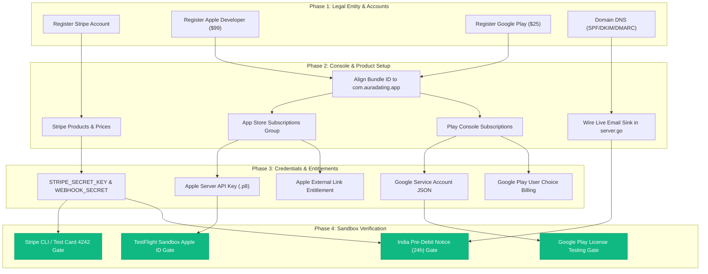

# Aura — External Billing Provider Setup Inventory & Owner Checklist

**Document File:** `BILLING_EXTERNAL_PROVIDER_SETUP_CHECKLIST.md`  
**Role:** Senior DevOps Engineer, Application Security Engineer & Full-Stack Release Engineer  
**Date:** October 15, 2026  
**Status:** Complete External Audit & Inventory  
**Operational Invariant:** Zero real charges initiated, zero live billing enabled, zero secrets exposed.

---

## 1. Executive Summary & Readiness Classification Matrix

Following the completion of **Billing Remediation Phase 1** (which wired the official `stripe-go/v74` SDK, built the Next.js `/membership` portal, published explicit legal terms, implemented mobile self-service cancellation, and verified fail-closed gating across 14 Go billing tests, 4 Web tests, and 13 Mobile tests), this inventory details the exact external account readiness, credential locations, and remaining blockers before any sandbox or production transaction can execute.

### Classification Categories:
1. **`CODE IMPLEMENTED`**: The internal Go structs, interfaces, methods, route handlers, or React Native client calls exist in the codebase.
2. **`ACCOUNT/CONFIGURATION MISSING`**: External developer accounts, merchant accounts, console configurations, products, or credentials do not exist or remain unconfigured.
3. **`SANDBOX NOT VERIFIED`**: Has not executed against an authentic external sandbox gateway (e.g. Stripe test mode, Apple Sandbox, Google Play License Testing).
4. **`BLOCKED`**: Execution is rejected immediately by the application's fail-closed security invariants or host configuration.
5. **`VERIFIED WITH EVIDENCE`**: Validated by unit tests, mock execution, static analysis, or automated test harnesses.

| Provider / Channel | Code Architecture | Account & Credentials | External Sandbox | Production Status | Overall Verdict |
| :--- | :--- | :--- | :--- | :--- | :--- |
| **Stripe (Direct Web Checkout & Subscriptions)** | `CODE IMPLEMENTED` & `VERIFIED WITH EVIDENCE` | `ACCOUNT/CONFIGURATION MISSING` | `SANDBOX NOT VERIFIED` | `BLOCKED` | **BLOCKED (Awaiting Test Keys & Webhook)** |
| **Apple App Store (StoreKit & Server API v2)** | `CODE IMPLEMENTED` & `VERIFIED WITH EVIDENCE` | `ACCOUNT/CONFIGURATION MISSING` | `SANDBOX NOT VERIFIED` | `BLOCKED` | **BLOCKED (Awaiting App Store Connect Setup)** |
| **Google Play (Play Billing & Developer API v3)** | `CODE IMPLEMENTED` & `VERIFIED WITH EVIDENCE` | `ACCOUNT/CONFIGURATION MISSING` | `SANDBOX NOT VERIFIED` | `BLOCKED` | **BLOCKED (Awaiting Play Console & Service Acct)** |
| **Email Delivery (OTPs, Resets & Pre-Debit Notices)**| `CODE IMPLEMENTED` (Interfaces exist) | `ACCOUNT/CONFIGURATION MISSING` | `SANDBOX NOT VERIFIED` | `BLOCKED` | **BLOCKED (Live Adapter Unwired in `server.go`)** |
| **SMS Delivery (Mobile Phone Verification OTPs)** | `CODE IMPLEMENTED` (Interfaces exist) | `ACCOUNT/CONFIGURATION MISSING` | `SANDBOX NOT VERIFIED` | `BLOCKED` | **BLOCKED (SMS Provider Unconfigured)** |
| **India Recurring Mandates (RBI E-Mandate)** | `CODE IMPLEMENTED` & `VERIFIED WITH EVIDENCE` | `ACCOUNT/CONFIGURATION MISSING` | `SANDBOX NOT VERIFIED` | `BLOCKED` | **BLOCKED (Awaiting Mandate Gateway & Email Sink)** |

---

## 2. Provider 1: Stripe (Web Direct Checkout & Subscriptions)

### 2.1 Status Classification
- **Go SDK & Service Code:** `CODE IMPLEMENTED` (`github.com/stripe/stripe-go/v74` in `go.mod`, `backend/internal/billing/provider.go`).
- **Consent Gating & Storage:** `CODE IMPLEMENTED` & `VERIFIED WITH EVIDENCE` (`TestExplicitConsentRequired`).
- **Web `/membership` Portal:** `CODE IMPLEMENTED` & `VERIFIED WITH EVIDENCE` (`web/src/app/membership/page.tsx`, `MembershipClient.tsx`).
- **Upcoming Invoice Webhook (`invoice.upcoming`):** `CODE IMPLEMENTED` & `VERIFIED WITH EVIDENCE` (`TestUpcomingInvoicePreDebitNotice`).
- **Stripe Account & API Keys:** `ACCOUNT/CONFIGURATION MISSING` (Only placeholder `sk_test_placeholder` and `whsec_test_placeholder` present).
- **External Sandbox Verification:** `SANDBOX NOT VERIFIED` (Backend fails closed with `ErrProviderNotConfigured`).
- **Overall Verdict:** `BLOCKED`.

### 2.2 Exact Environment Variable Names
| Variable Name | Required Environment | Purpose | Where Obtained | Secure Storage Location |
| :--- | :--- | :--- | :--- | :--- |
| `STRIPE_SECRET_KEY` | Dev, Staging, Prod | Authenticates Go backend with Stripe API (`sk_test_...` in dev/staging, `sk_live_...` in prod). | Stripe Dashboard &rarr; Developers &rarr; API keys &rarr; Secret key. | Local `.env` (gitignored); AWS Secrets Manager / Vault for staging & prod. **Never commit to git.** |
| `STRIPE_WEBHOOK_SECRET` | Dev, Staging, Prod | Cryptographic signing secret (`whsec_...`) to verify HMAC-SHA256 signature on incoming webhooks. | Stripe Dashboard &rarr; Developers &rarr; Webhooks &rarr; Add endpoint &rarr; Signing secret. (Stripe CLI `stripe listen` locally). | Local `.env` (gitignored); AWS Secrets Manager / Vault for staging & prod. **Never commit to git.** |

### 2.3 Verified Code, Interfaces & Webhooks (Empirical Audit)
- **SDK Present:** `github.com/stripe/stripe-go/v74` v74.30.0 in `backend/go.mod`.
- **Checkout Session API:** `StripeAdapter.CreateCheckoutSession` calls `stripeCheckout.New(params)` with:
  - `ClientReferenceID = userID`
  - `CustomerEmail = userEmail`
  - `LineItems` with dynamic catalog prices
  - `Params.Metadata["user_id"]` and `Params.Metadata["plan_code"]`
  - Fails closed immediately if `s.secretKey == ""` or contains `"placeholder"`.
- **Webhook Handlers in `StripeAdapter.ParseAndVerifyWebhook`:**
  - `checkout.session.completed` &rarr; activates initial subscription, writes `payment_transactions`, grants entitlements.
  - `invoice.payment_succeeded` &rarr; updates renewal period, writes renewal transaction, refreshes entitlements.
  - `invoice.payment_failed` &rarr; transitions subscription to `PAST_DUE`.
  - `invoice.upcoming` &rarr; constructs `PreDebitNotice` and calls `notificationSink.DeliverPreDebitNotice`.
  - `customer.subscription.deleted` &rarr; marks subscription `EXPIRED` and revokes entitlements in PostgreSQL.
  - `charge.refunded` &rarr; marks transaction `REFUNDED` and claws back active entitlements.
  - Signature verification uses `webhook.ConstructEventWithOptions(rawBody, sigHeader, secret, ...)`.

### 2.4 Owner Actions Required
1. **Register Stripe Account:** Create and verify the Aura business entity in Stripe Dashboard.
2. **India Regulatory Warning (Do Not Assume Approval):** If the entity is registered in India, Stripe India operates on an invite/approval basis with strict RBI compliance checks, requiring GSTIN, domestic IEC, and signed mandate agreements. The owner must confirm recurring billing capabilities with Stripe Support.
3. **Configure Stripe Dashboard Parameters:**
   - Statement Descriptor: `AURA*DATING` (max 22 characters).
   - Shortened Descriptor: `AURA`.
   - Support Phone and URL configured.
4. **Create Canonical Products & Prices in Stripe Dashboard (Matching `billing_products` catalog):**
   - `AURA_PLUS_MONTHLY`: $19.99 / month (recurring)
   - `AURA_PLUS_ANNUAL`: $119.88 / year (recurring)
   - `AURA_BLACK_MONTHLY`: $39.99 / month (recurring)
   - `AURA_BLACK_ANNUAL`: $239.88 / year (recurring)
   - `BOOST_SINGLE`: $4.99 (one-time consumable)
   - `BOOST_5PACK`: $19.99 (one-time consumable)
   - `SUPERSPARK_5PACK`: $9.99 (one-time consumable)
5. **Configure Stripe Customer Portal:** Enable self-service cancellation, update payment method, and invoice download under Settings &rarr; Customer portal.
6. **Configure Webhook Endpoint:** Add `https://api.staging.auradating.com/api/v1/billing/webhooks/stripe` listening for the 6 events listed in 2.3, copy `whsec_...` to secrets manager.

### 2.5 Sandbox Tests Required
- Run Stripe CLI forwarder: `stripe listen --forward-to localhost:8080/api/v1/billing/webhooks/stripe`.
- Trigger test checkout using Stripe test card `4242 4242 4242 4242` and verify `checkout.session.completed` transitions `user_entitlements` in PostgreSQL.
- Trigger test dispute (`stripe trigger charge.dispute.created`) and verify entitlement suspension.
- Trigger `stripe trigger invoice.upcoming` and verify pre-debit notice dispatch.

---

## 3. Provider 2: Apple App Store (StoreKit & App Store Server API v2)

### 3.1 Status Classification
- **Client StoreKit Integration:** `CODE IMPLEMENTED` (`react-native-iap` in `apps/mobile/src/services/billing/storeBilling.ts`).
- **Server Receipt Validation Invariants:** `CODE IMPLEMENTED` & `VERIFIED WITH EVIDENCE` (`TestStoreReceiptVerification` in `backend/internal/billing/billing_test.go`).
- **Storefront Policy Engine (Guideline 3.1.1):** `CODE IMPLEMENTED` & `VERIFIED WITH EVIDENCE` (`TestStorefrontBillingPolicy_Resolution`).
- **Mobile UI Cancellation Routing:** `CODE IMPLEMENTED` (`apps/mobile/app/(tabs)/membership.tsx`).
- **App Store Connect Setup & Subscriptions:** `ACCOUNT/CONFIGURATION MISSING`.
- **App Store Server API v2 Credentials:** `ACCOUNT/CONFIGURATION MISSING` / `BLOCKED`.
- **App Store Server Notifications v2 (ASSN v2):** `ACCOUNT/CONFIGURATION MISSING` / `BLOCKED`.
- **StoreKit External Purchase Link Entitlement Approval:** `NOT ENROLLED / BLOCKED`.
- **Overall Verdict:** `BLOCKED`.

### 3.2 Architectural Resolution: Dynamic Store Identifier Configuration
> [!NOTE]
> **Dynamic Identifier Configuration Implemented (Safe for Pre-Release Rebrand):**
> - In `apps/mobile/app.json`: Native identifiers remain `com.aura.dating` for current local builds without permanent lock-in.
> - In `backend/internal/config/config.go`: Expected identifiers are explicitly configured via `APPLE_BUNDLE_ID` and `GOOGLE_PLAY_PACKAGE_NAME` (defaulting to `com.aura.dating` in dev, strictly required in staging/production).
> - In `backend/internal/billing/provider.go`: `AppleAppStoreAdapter` and `GooglePlayAdapter` strictly enforce the configured identifiers and fail closed if unconfigured (`ErrProviderNotConfigured`) or mismatched (`ErrReceiptValidationFailed`).
> - In `apps/mobile/app/(tabs)/membership.tsx`: Store cancellation URLs extract the package name dynamically from `Constants.expoConfig?.android?.package`.
> - **Pre-Release Rebrand Safety:** Before registering production app records in App Store Connect and Google Play Console, the final rebranded identifier only needs to be set in `apps/mobile/app.json` and the deployment environment variables, with zero code alterations required.

### 3.3 StoreKit External Purchase Link Entitlement Reality Check
> [!IMPORTANT]
> **Dating Platforms Are NOT Reader Apps:**
> - Apple App Store Review Guideline 3.1.3(a) strictly excludes dating apps from the "Reader App" external linkout exemption.
> - Direct website linkout from the iOS app is legally permitted **ONLY** in the United States (StoreKit External Purchase Link Entitlement US) and European Union (Alternative Terms Addendum / DMA).
> - **Apple Commission Still Applies:** Apple collects a **27% commission** (or 12% for Small Business Program members) on transactions occurring within 7 days of linkout. Developers must submit monthly transaction reports to Apple.
> - **Entitlement Approval Cannot Be Assumed:** The owner must apply for and receive approval from Apple Developer Relations before compiling the entitlement key into the iOS build.

### 3.4 Exact Environment Variable Names
| Variable Name | Required Environment | Purpose | Where Obtained | Secure Storage Location |
| :--- | :--- | :--- | :--- | :--- |
| `APPLE_SHARED_SECRET` | Dev, Staging (Legacy) | Legacy sandbox receipt verification shared secret (currently in `config.go`). | App Store Connect &rarr; Apps &rarr; In-App Purchases &rarr; App-Specific Shared Secret. | Secrets Manager / `.env`. |
| `APPLE_KEY_ID` | Staging, Prod (v2 API) | 10-character Key ID for App Store Server API v2 JWT generation. | App Store Connect &rarr; Users and Access &rarr; Integrations &rarr; In-App Purchase. | Secrets Manager. |
| `APPLE_ISSUER_ID` | Staging, Prod (v2 API) | UUID Issuer ID from App Store Connect. | App Store Connect &rarr; Users and Access &rarr; Integrations. | Secrets Manager. |
| `APPLE_BUNDLE_ID` | Staging, Prod | Bundle Identifier (`com.auradating.app`). | App Store Connect &rarr; App Information. | Secrets Manager / Config. |
| `APPLE_PRIVATE_KEY_P8` | Staging, Prod (v2 API) | PKCS#8 private key content (`.p8` file) to sign server-to-server API calls. | Downloaded once from App Store Connect when creating the API key. | Secure Secrets Manager (never in filesystem or git). |
| `APPLE_ENVIRONMENT` | Staging, Prod | Target environment: `Sandbox` or `Production`. | Manual config. | Config. |

### 3.5 Owner Actions Required
1. **Enroll in Apple Developer Program:** As an Organization ($99/USD/year), complete D-U-N-S verification.
2. **Register App ID & Capabilities:** In Apple Developer portal, create App ID matching `com.auradating.app`. Enable In-App Purchase capability.
3. **Configure Subscription Group in App Store Connect:**
   - Group Name: "Aura Memberships".
   - Create In-App Purchase products: `AURA_PLUS_MONTHLY`, `AURA_PLUS_ANNUAL`, `AURA_BLACK_MONTHLY`, `AURA_BLACK_ANNUAL`.
   - Create Consumable products: `BOOST_SINGLE`, `BOOST_5PACK`, `SUPERSPARK_5PACK`.
   - Configure pricing tiers, subscription durations, localized descriptions, and review screenshots.
4. **Generate App Store Connect API Key:** In Users and Access &rarr; Integrations &rarr; In-App Purchase, generate an API key and securely store the `.p8` file, Key ID, and Issuer ID.
5. **Configure App Store Server Notifications v2:** In App Store Connect &rarr; App &rarr; App Store Server Notifications, set URL to `https://api.staging.auradating.com/api/v1/billing/webhooks/apple` (v2 notifications).
6. **Submit StoreKit External Purchase Link Entitlement Application:** If desiring web checkout links in US/EU iOS builds, apply via Apple Developer account.
7. **Create Sandbox Testers:** Create sandbox Apple ID test accounts in App Store Connect for TestFlight billing checks.

---

## 4. Provider 3: Google Play (Play Billing & Developer API v3)

### 4.1 Status Classification
- **Client Play Billing Integration:** `CODE IMPLEMENTED` (`react-native-iap` in `storeBilling.ts`).
- **Server Purchase Verification Invariants:** `CODE IMPLEMENTED` & `VERIFIED WITH EVIDENCE` (`TestUnconfiguredProviderCredentialsBlocked` in `billing_test.go`).
- **User Choice Billing (UCB) Storefront Policy:** `CODE IMPLEMENTED` & `VERIFIED WITH EVIDENCE` (`TestStorefrontBillingPolicy_Resolution`).
- **Google Play Console App & Subscriptions:** `ACCOUNT/CONFIGURATION MISSING`.
- **Google Cloud Service Account & API Access:** `ACCOUNT/CONFIGURATION MISSING` / `BLOCKED`.
- **Real-Time Developer Notifications (RTDN via Pub/Sub):** `ACCOUNT/CONFIGURATION MISSING` / `BLOCKED`.
- **User Choice Billing (Alternative Billing) Enrollment:** `NOT ENROLLED / BLOCKED`.
- **Overall Verdict:** `BLOCKED`.

### 4.2 User Choice Billing (Alternative Billing) Reality Check
> [!IMPORTANT]
> **Google Play User Choice Billing Does Not Eliminate Fees:**
> - Under Google Play's User Choice Billing (UCB) program (available in US, EU/EEA, IN, KR, JP, BR, AU, GB, CA), developers may present both Google Play Billing and alternative direct web checkout.
> - Google reduces its service fee by **only 4%** (charging **11%** instead of 15% for tier 1; or **26%** instead of 30%).
> - Developers must report alternative billing transactions to Google via the Alternative Billing APIs and settle monthly service fees.
> - **Enrollment Required:** The owner must accept the Alternative Billing Addendum in Google Play Console.

### 4.3 Exact Environment Variable Names
| Variable Name | Required Environment | Purpose | Where Obtained | Secure Storage Location |
| :--- | :--- | :--- | :--- | :--- |
| `GOOGLE_PLAY_CREDENTIALS_JSON` | Dev, Staging, Prod | Service account private key JSON authorizing backend to verify purchases via `androidpublisher/v3`. | Google Cloud Console &rarr; IAM &rarr; Service Accounts &rarr; Keys &rarr; JSON. | Secrets Manager / local `.env` (gitignored). |
| `GOOGLE_PLAY_PACKAGE_NAME` | Dev, Staging, Prod | Android package identifier (`com.auradating.app` or `com.aura.dating`). | Play Console &rarr; App details. | Config / `.env`. |
| `GOOGLE_PLAY_PUBSUB_TOPIC` | Staging, Prod | Pub/Sub topic receiving Real-Time Developer Notifications (RTDN). | Google Cloud Console &rarr; Cloud Pub/Sub. | Config / `.env`. |

### 4.4 Owner Actions Required
1. **Register Google Play Developer Account:** Complete identity and organization verification ($25 USD one-time fee).
2. **Create Application in Play Console:** Register package name matching mobile build configuration.
3. **Configure Subscriptions & In-App Products:**
   - In Play Console &rarr; Monetize &rarr; Subscriptions, create base plans matching `AURA_PLUS_MONTHLY`, `AURA_PLUS_ANNUAL`, `AURA_BLACK_MONTHLY`, `AURA_BLACK_ANNUAL`.
   - In In-app products, create consumables matching `BOOST_SINGLE`, `BOOST_5PACK`, `SUPERSPARK_5PACK`.
4. **Create Google Cloud Platform (GCP) Project & Service Account:**
   - Enable "Google Play Android Developer API" in GCP API Library.
   - Create Service Account with name `aura-billing-verifier`.
   - Generate JSON key file.
5. **Link Service Account in Google Play Console:**
   - In Play Console &rarr; API access, link the GCP project.
   - Grant the service account permissions: "View financial data, orders, and cancellation survey responses" and "Manage orders and subscriptions".
6. **Set up Real-Time Developer Notifications (RTDN):**
   - Create a Cloud Pub/Sub topic (e.g. `aura-play-billing-rtdn`).
   - Grant publisher role to `google-play-developer-notifications@system.gserviceaccount.com`.
   - Create a Push Subscription pointing to `https://api.staging.auradating.com/api/v1/billing/webhooks/google`.
7. **Enroll in User Choice Billing (Alternative Billing):** In Play Console &rarr; Monetization setup &rarr; Alternative billing, complete enrollment declaration for supported target countries.
8. **Configure License Testing:** Add tester Gmail addresses under Play Console &rarr; Setup &rarr; License testing with `RESPOND_NORMALLY` test license.

---

## 5. Provider 4: Outbound Email & SMS Delivery (OTPs, Password Resets & Pre-Debit Notices)

### 5.1 Status Classification
- **Delivery Sink Interfaces:** `CODE IMPLEMENTED` (`NotificationDeliverySink` in `identity/service.go`, `PreDebitNotificationSink` in `billing/service.go`).
- **Test In-Memory Sinks:** `CODE IMPLEMENTED` & `VERIFIED WITH EVIDENCE` (`TestPostgres_RealAuthVerificationGate`, `TestUpcomingInvoicePreDebitNotice`).
- **Live Dispatch Adapter in `cmd/api` & `server.go`:** `CODE NOT WIRED` (Currently `nil` in production `server.go`).
- **Transactional Email Provider Account:** `ACCOUNT/CONFIGURATION MISSING`.
- **Domain DNS Verification (SPF, DKIM, DMARC for `auradating.com`):** `ACCOUNT/CONFIGURATION MISSING`.
- **Transactional SMS Provider Account (Twilio / SNS):** `ACCOUNT/CONFIGURATION MISSING`.
- **Overall Verdict:** `BLOCKED`.

### 5.2 Exact Environment Variable Names
| Variable Name | Required Environment | Purpose | Where Obtained | Secure Storage Location |
| :--- | :--- | :--- | :--- | :--- |
| `EMAIL_PROVIDER_API_KEY` | Staging, Prod | API key for transactional email delivery (e.g. Resend, SendGrid, Postmark, AWS SES). | Transactional email provider dashboard. | Secrets Manager. |
| `EMAIL_FROM_ADDRESS` | All | Default system from address: `Aura Safety Desk <no-reply@auradating.com>`. | Domain admin. | Environment config. |
| `BILLING_EMAIL_FROM_ADDRESS` | All | Dedicated billing sender: `Aura Billing Desk <billing@auradating.com>`. | Domain admin. | Environment config. |
| `SMTP_HOST` / `SMTP_PORT` / `SMTP_USER` / `SMTP_PASS` | Staging, Prod (if SMTP) | Standard SMTP credentials for outbound mail delivery. | Email host dashboard. | Secrets Manager. |
| `TWILIO_ACCOUNT_SID` / `TWILIO_AUTH_TOKEN` | Staging, Prod (if SMS) | Account credentials for SMS OTP delivery. | Twilio Console. | Secrets Manager. |
| `TWILIO_FROM_NUMBER` | Staging, Prod (if SMS) | Approved phone number or Alphanumeric Sender ID (`AURA`). | Twilio Console. | Secrets Manager. |

### 5.3 Owner Actions Required
1. **Select & Provision Transactional Email Provider:** Recommended: AWS SES, Resend, Postmark, or SendGrid.
2. **Configure Domain DNS Records on Domain Registrar for `auradating.com`:**
   - SPF TXT record: `v=spf1 include:<provider-spf> ~all`.
   - DKIM CNAME/TXT records provided by the email service.
   - DMARC TXT record: `v=DMARC1; p=quarantine; rua=mailto:dmarc@auradating.com; pct=100`.
   - MX / Custom Mail-From sub-domain (e.g. `mail.auradating.com`).
3. **Verify Senders:** Verify `no-reply@auradating.com` and `billing@auradating.com`.
4. **Implement Production Delivery Adapter:** Author Go adapter implementing `identity.NotificationDeliverySink` and `billing.PreDebitNotificationSink` calling the chosen email API/SMTP, and wire it in `backend/internal/server/server.go`.
5. **SMS Regulatory Registration (If SMS verification is chosen):**
   - In United States: Complete A2P 10DLC Brand and Campaign registration.
   - In India: Complete TRAI DLT registration (Principal Entity, Sender Headers, Consent Templates, Content Templates) on telecom portal (e.g. Jio, Airtel, Vodafone DLT).

---

## 6. Provider 5: India Recurring-Payment Mandates (RBI E-Mandate Compliance)

### 6.1 Status Classification
- **India E-Mandate Gating Invariant:** `CODE IMPLEMENTED` & `VERIFIED WITH EVIDENCE` (`TestIndiaRecurringPreDebitCompliance` in `billing_test.go`).
- **Pre-Debit Event Handling:** `CODE IMPLEMENTED` & `VERIFIED WITH EVIDENCE` (`TestUpcomingInvoicePreDebitNotice`).
- **Live Mandate Gateway Integration:** `ACCOUNT/CONFIGURATION MISSING` / `BLOCKED`.
- **Pre-Debit Cardholder SMS/Email Delivery:** `ACCOUNT/CONFIGURATION MISSING` / `BLOCKED`.
- **Customer Mandate Management Portal:** `ACCOUNT/CONFIGURATION MISSING`.
- **Overall Verdict:** `BLOCKED`.

### 6.2 Regulatory Directives (RBI Circulars on Recurring E-Mandates)
Under Reserve Bank of India (RBI) circulars (DPSS.CO.PD.No.447/02.14.003/2019-20 and subsequent amendments):
1. **Registration & Initial AFA:** First transaction must strictly use Additional Factor of Authentication (AFA via 3DS/OTP). The customer must explicitly accept the recurring debit limit (maximum ₹15,000 without fresh OTP for standard dating memberships), validity period, and frequency.
2. **Subsequent Debits (Auto-Renewal):** Renewal debits under ₹15,000 do not require fresh OTP.
3. **Mandatory 24-Hour Pre-Debit Notification:** Merchant/Aggregator **MUST** dispatch a pre-debit notice to cardholder via SMS or email at least 24 hours prior to every recurring debit. The notice must specify:
   - Debit amount
   - Scheduled debit date
   - Merchant name ("Aura")
   - Mandate reference number
   - Direct link allowing customer to opt out of the specific transaction or revoke the mandate.
4. **Enforced Application Invariant:** `backend/internal/billing/service.go` strictly blocks Indian recurring checkout requests (`Storefront == "IN"` or `Currency == "INR"`) with `ErrIndiaMandateNotCompliant` if `notificationSink == nil`.

### 6.3 Exact Environment Variable Names
| Variable Name | Required Environment | Purpose | Where Obtained | Secure Storage Location |
| :--- | :--- | :--- | :--- | :--- |
| `INDIA_MANDATE_AGGREGATOR` | Staging, Prod | Declares active mandate gateway: `STRIPE_INDIA`, `RAZORPAY`, or `CASHFREE`. | Gateway account. | Config. |
| `INDIA_EMANDATE_MAX_AMOUNT_PAISE` | Staging, Prod | Enforced regulatory recurring cap (default `1500000` = ₹15,000). | RBI circular. | Config. |
| `PRE_DEBIT_NOTIFICATION_HOURS_BEFORE` | Staging, Prod | Advance notification window (default `48` hours; minimum 24 hours). | Operational policy. | Config. |
| `TRAI_DLT_ENTITY_ID` / `TRAI_DLT_TEMPLATE_ID` | Staging, Prod (if SMS) | Approved Indian Telecom commercial communication identifiers. | Indian DLT portal. | Secrets Manager. |

### 6.4 Owner Actions Required
1. **Clarify Payment Gateway Suitability for India Recurring Debits:**
   - Stripe India has strict domestic e-mandate onboarding rules. If Stripe India does not support e-mandates for the Aura legal entity, evaluate an RBI-compliant domestic aggregator (e.g. Razorpay Subscriptions).
2. **Wire Live `PreDebitNotificationSink` in `server.go`:**
   - Connect the email/SMS worker so that `invoice.upcoming` webhooks successfully send the itemized pre-debit notice to daters.
3. **TRAI DLT Portal Registration (if using SMS in India):**
   - Register the entity name, sender ID (`AURADT`), and pre-debit transactional template text.

---

## 7. Master Missing Setup Items, Evidence & Dependency Table

| ID | Domain | Missing Setup Item | Empirical Code/Audit Evidence | Dependency | Owner Action Required |
| :--- | :--- | :--- | :--- | :--- | :--- |
| **`M-01`** | **Stripe** | Test & Live API Keys (`STRIPE_SECRET_KEY`, `STRIPE_WEBHOOK_SECRET`) | `config.go:133-134` (`sk_test_placeholder`), `TestUnconfiguredProviderCredentialsBlocked` passes (blocked). | Stripe Developer Account | Register Stripe account; generate test keys in Dashboard; configure statement descriptor `AURA*DATING`. |
| **`M-02`** | **Stripe** | Canonical Products & Recurring Prices in Stripe Dashboard | `BILLING_AUTO_RENEWAL_AND_CHECKOUT_AUDIT.md:37` (Products in PostgreSQL only; missing in Stripe). | `M-01` | Create 7 products & recurring prices in Stripe Dashboard matching database `billing_products`. |
| **`M-03`** | **Stripe** | Webhook Listener Endpoint Setup | `server.go:347` (`/api/v1/billing/webhooks/stripe` active in code; unconfigured in Stripe). | `M-01`, Public Staging URL | Add webhook endpoint in Stripe Dashboard listening for 6 required events. |
| **`M-04`** | **Apple** | Canonical Bundle ID Alignment | `app.json:11` (`com.aura.dating`) vs `provider.go:461` (`com.auradating.app`). | None | Align `apps/mobile/app.json` to canonical Bundle ID `com.auradating.app` before creating App ID. |
| **`M-05`** | **Apple** | App Store Connect App ID & Subscriptions Group | `provider.go:436` (sharedSecret placeholder), `storeBilling.ts:202` (IAP calls unwired in store). | Apple Developer Account ($99) | Create App ID in Developer Portal; configure Subscription Group and 7 products in App Store Connect. |
| **`M-06`** | **Apple** | App Store Server API v2 Credentials (`.p8`, Key ID, Issuer ID) | `provider.go:500-514` (stub returns mock `DID_RENEW`; server API unwired). | `M-05` | Generate In-App Purchase API Key in App Store Connect; download `.p8` and record Key ID and Issuer ID. |
| **`M-07`** | **Apple** | StoreKit External Purchase Link Entitlement (US & EU) | `policy.go:111-125` (entitlement required in code; Reader App rules inapplicable). | `M-05` | Apply for StoreKit External Purchase Link Entitlement in Apple Developer portal. |
| **`M-08`** | **Google** | Google Play Console App & Subscriptions Setup | `provider.go:537` (credentialsJSON placeholder), `storeBilling.ts:206` (calls unwired in store). | Play Console Account ($25) | Create App in Play Console; create 4 subscription base plans and 3 in-app products matching catalog. |
| **`M-09`** | **Google** | Google Cloud Service Account & API Access | `config.go:136` (`GOOGLE_PLAY_CREDENTIALS_JSON` empty). | `M-08` | Create GCP service account with `androidpublisher` API; grant permissions in Play Console API Access. |
| **`M-10`** | **Google** | Cloud Pub/Sub Topic for RTDN Webhooks | `provider.go:599-613` (stub returns mock `SUBSCRIPTION_RENEWED`; Pub/Sub unwired). | `M-09` | Create Pub/Sub topic and push subscription pointing to `/api/v1/billing/webhooks/google`. |
| **`M-11`** | **Google** | User Choice Billing (Alternative Billing) Declaration | `policy.go:73-89` (UCB logic ready; alternative billing unverified in store). | `M-08` | Accept Alternative Billing declaration in Play Console for US, EU, IN, etc. |
| **`M-12`** | **Email/SMS** | Domain DNS Records (SPF, DKIM, DMARC) for `auradating.com` | `web/src/app/legal/terms/page.tsx:55` (`billing@auradating.com` published; no live mailserver). | Domain Registrar | Configure SPF, DKIM, and DMARC DNS records for `auradating.com` with transactional email provider. |
| **`M-13`** | **Email/SMS** | Production Email & Pre-Debit Notification Adapter | `server.go:152,334` (`notificationSink` left `nil` on `identSvc` and `billingSvc`). | `M-12` | Implement production email adapter in Go backend and wire into `server.go`. |
| **`M-14`** | **India** | RBI Recurring Mandate Gateway Eligibility | `service.go:63` (`ErrIndiaMandateNotCompliant` blocks checkouts without sink). | `M-01`, `M-13` | Confirm Stripe India or Razorpay recurring e-mandate onboarding approval and terms. |

---

## 8. Master Dependency Graph

---

## 9. Next Immediate Action for Owner

> [!IMPORTANT]
> ### The Single Next Action for the Owner:
> **Register Stripe Developer Account & Generate Development Test Keys.**
> 1. **Store Identifiers Safely Unlocked:** The bundle identifier mismatch has been resolved via explicit environment variables (`APPLE_BUNDLE_ID` and `GOOGLE_PLAY_PACKAGE_NAME`) and dynamic native resolution. The owner can safely rebrand/rename the app at any time prior to store release without changing verification code.
> 2. **Register Stripe Account & Generate Test Keys:** Log into [dashboard.stripe.com](https://dashboard.stripe.com), obtain the development `sk_test_...` key and `whsec_...` webhook secret, and provide them to the staging environment.
>
> Once Stripe test credentials are provided, end-to-end sandbox checkout on web `/membership` can be verified immediately without touching production accounts or initiating real charges.
