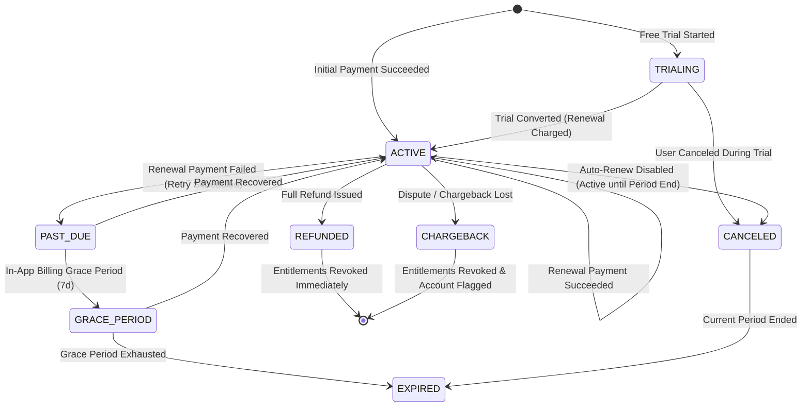
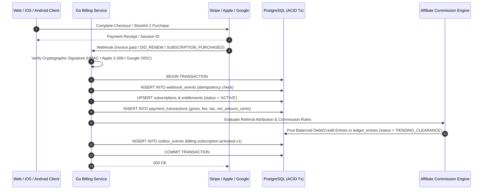

# Aura Platform — Subscriptions, Billing, Boosts & Refunds Specification (`BILLING_SPEC.md`)

**Providers**: Stripe Billing (Web), Apple App Store Server API v2 (iOS), Google Play Billing v7 (Android)

---

## 1. Product Catalog & Entitlement Matrix

| Tier / SKU | Billing Cadence | Base Price (USD) | Included Entitlements |
| :--- | :--- | :--- | :--- |
| **`AURA_FREE`** | Free | `$0.00` | 20 Likes/day, basic gender/age/distance filters, standard matching & messaging. |
| **`AURA_PLUS_MONTHLY`** | Monthly Recurring | `$19.99 / mo` | Unlimited Likes, See Who Liked You, 5 Rewinds/day, Discrete App Icon, Advanced Relationship-Intent Filters. |
| **`AURA_PLUS_ANNUAL`** | Annual Recurring | `$119.88 / yr` | All `Aura Plus` benefits at 50% annual savings. |
| **`AURA_BLACK_MONTHLY`** | Monthly Recurring | `$34.99 / mo` | All `Aura Plus` benefits + Incognito Mode, Global Passport, Priority Likes, Read Receipts, 1 Free Boost/month, 5 Super Sparks/week. |
| **`AURA_BLACK_ANNUAL`** | Annual Recurring | `$209.88 / yr` | All `Aura Black` benefits at 50% annual savings. |
| **`BOOST_SINGLE` / `BOOST_5PACK`** | Consumable One-Time | `$4.99` / `$17.99` | 30-minute `3.0x` discovery ranking multiplier. |
| **`SUPERSPARK_5PACK`** | Consumable One-Time | `$9.99` | 5 priority intro-message Super Sparks. |

---

## 2. Subscription Lifecycle State Machine

---

## 3. Omni-Channel Payment & Webhook Flow

---

## 4. Refunds, Chargebacks & Net Revenue Calculation

1. **Net Revenue Definition**:
   $$\text{Net Revenue Cents} = \text{Gross Charge Cents} - \text{Sales Tax / VAT Cents} - \text{Payment Processor / App Store Fee Cents}$$
   - Stripe Web default processor fee: $\approx 2.9\% + \$0.30$.
   - Apple App Store / Google Play Small Business Program fee: $15\%$ (or $30\%$ standard rate).
2. **Immediate Revocation on Refund/Chargeback**:
   - Upon receipt of `charge.refunded`, `charge.dispute.created` (Stripe), `REFUND` (Apple), or `SUBSCRIPTION_REVOKED` (Google), the user's `subscriptions.status` transitions to `REFUNDED` or `CHARGEBACK` and paid `entitlements` are revoked immediately.
   - Emits `billing.payment.refunded.v1`, triggering an automatic reversing journal entry in the Affiliate Commission Ledger.
