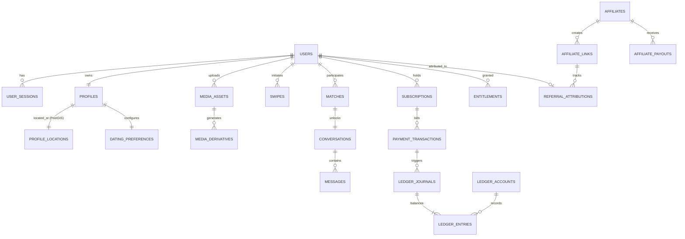

# Aura Platform — Database Architecture & Schema Specification (`DATABASE.md`)

**Database Engine**: PostgreSQL 16+ with **PostGIS 3.4+** (`postgis`), `pgcrypto`, and `citext` extensions.  
**Migration Tooling**: Versioned SQL migrations embedded in the Go binary (`backend/migrations/*.sql`) managed by `cmd/migrate`.

---

## 1. Core Entity-Relationship Diagram



---

## 2. Extension & Spatial Configuration

```sql
CREATE EXTENSION IF NOT EXISTS "pgcrypto";
CREATE EXTENSION IF NOT EXISTS "citext";
CREATE EXTENSION IF NOT EXISTS "postgis";
```

### Geospatial Design (`profile_locations`)
- Coordinates are stored as `GEOGRAPHY(Point, 4326)` for accurate spherical distance calculations in meters.
- Indexed with a PostGIS spatial index: `CREATE INDEX idx_profile_locations_geog ON profile_locations USING GIST (coordinates);`
- **Privacy Rule**: Raw `coordinates` are queried only inside server-side SQL `ST_DWithin` expressions and are never serialized to client API responses. Clients receive only `fuzzed_distance_km` and `city_display_name`.

---

## 3. Domain Table Specifications

### 3.1 Identity & Access (`users`, `user_sessions`, `oauth_identities`)
- **`users`**:
  - `id UUID PRIMARY KEY DEFAULT gen_random_uuid()`
  - `email CITEXT UNIQUE NOT NULL`
  - `phone_e164 VARCHAR(20) UNIQUE`
  - `password_hash TEXT` (Argon2id encoded parameter string)
  - `status VARCHAR(32) NOT NULL DEFAULT 'ACTIVE'` (`ACTIVE`, `SUSPENDED`, `BANNED`, `DEACTIVATED`, `DELETED`)
  - `role VARCHAR(32) NOT NULL DEFAULT 'MEMBER'` (`MEMBER`, `TRUST_AND_SAFETY`, `FINANCE_ADMIN`, `EDITORIAL_CMS`, `SUPER_ADMIN`)
  - `email_verified_at TIMESTAMPTZ`, `phone_verified_at TIMESTAMPTZ`, `last_active_at TIMESTAMPTZ`
  - `created_at TIMESTAMPTZ NOT NULL DEFAULT NOW()`, `updated_at TIMESTAMPTZ NOT NULL DEFAULT NOW()`
- **`user_sessions`**:
  - `id UUID PRIMARY KEY`, `user_id UUID NOT NULL REFERENCES users(id) ON DELETE CASCADE`
  - `refresh_token_hash BYTEA UNIQUE NOT NULL` (SHA-256 of opaque refresh token)
  - `device_fingerprint VARCHAR(128)`, `user_agent TEXT`, `ip_address INET`
  - `expires_at TIMESTAMPTZ NOT NULL`, `revoked_at TIMESTAMPTZ`, `created_at TIMESTAMPTZ NOT NULL DEFAULT NOW()`

### 3.2 Profiles, LGBTQ+ Identities & Preferences (`profiles`, `dating_preferences`, `profile_locations`)
- **`profiles`**:
  - `user_id UUID PRIMARY KEY REFERENCES users(id) ON DELETE CASCADE`
  - `display_name VARCHAR(64) NOT NULL`
  - `birthdate DATE NOT NULL` (Enforced age $\ge 18$ via `CHECK` constraint)
  - `bio TEXT`, `pronouns VARCHAR(64)[] NOT NULL DEFAULT '{}'`
  - `gender_identities VARCHAR(64)[] NOT NULL`
  - `sexual_orientations VARCHAR(64)[] NOT NULL`
  - `relationship_intents VARCHAR(64)[] NOT NULL`
  - `relationship_structure VARCHAR(32)` (`MONOGAMOUS`, `ENM`, `POLYAMOROUS`, `OPEN`, `EXPLORING`)
  - `visibility_settings JSONB NOT NULL DEFAULT '{}'` (Granular attribute privacy toggles)
  - `is_photo_verified BOOLEAN NOT NULL DEFAULT FALSE`
  - `discrete_mode_enabled BOOLEAN NOT NULL DEFAULT FALSE`
  - `incognito_enabled BOOLEAN NOT NULL DEFAULT FALSE`
- **`profile_locations`**:
  - `user_id UUID PRIMARY KEY REFERENCES users(id) ON DELETE CASCADE`
  - `coordinates GEOGRAPHY(Point, 4326) NOT NULL`
  - `passport_coordinates GEOGRAPHY(Point, 4326)` (Active when Global Passport entitlement is used)
  - `city_name VARCHAR(120)`, `country_code CHAR(2) NOT NULL`
  - `updated_at TIMESTAMPTZ NOT NULL DEFAULT NOW()`
- **`dating_preferences`**:
  - `user_id UUID PRIMARY KEY REFERENCES users(id) ON DELETE CASCADE`
  - `min_age SMALLINT NOT NULL DEFAULT 18 CHECK (min_age >= 18)`
  - `max_age SMALLINT NOT NULL DEFAULT 99 CHECK (max_age >= min_age)`
  - `max_distance_km SMALLINT NOT NULL DEFAULT 50 CHECK (max_distance_km BETWEEN 1 AND 500)`
  - `preferred_genders VARCHAR(64)[] NOT NULL`
  - `preferred_intents VARCHAR(64)[] NOT NULL`
  - `verified_profiles_only BOOLEAN NOT NULL DEFAULT FALSE`

### 3.3 Media Pipeline (`media_assets`, `media_derivatives`)
- **`media_assets`**:
  - `id UUID PRIMARY KEY DEFAULT gen_random_uuid()`
  - `owner_user_id UUID NOT NULL REFERENCES users(id) ON DELETE CASCADE`
  - `media_type VARCHAR(16) NOT NULL CHECK (media_type IN ('IMAGE', 'VIDEO', 'VOICE_NOTE'))`
  - `purpose VARCHAR(32) NOT NULL CHECK (purpose IN ('PROFILE_GALLERY', 'SELFIE_VERIFICATION', 'CHAT_ATTACHMENT'))`
  - `status VARCHAR(32) NOT NULL DEFAULT 'PENDING_UPLOAD'` (`PENDING_UPLOAD`, `UPLOADED`, `PROCESSING`, `MODERATION_PENDING`, `READY`, `REJECTED`, `FAILED`, `PURGED`)
  - `quarantine_bucket VARCHAR(128) NOT NULL`, `quarantine_key TEXT NOT NULL`
  - `original_sha256 VARCHAR(64)`, `original_mime VARCHAR(64)`, `original_size_bytes BIGINT`
  - `width_px INT`, `height_px INT`, `duration_ms INT`
  - `exif_stripped BOOLEAN NOT NULL DEFAULT FALSE`
  - `moderation_verdict VARCHAR(32)` (`APPROVED`, `REJECTED_NSFW`, `REJECTED_CSAM`, `MANUAL_REVIEW`)
  - `original_purge_after TIMESTAMPTZ`
  - `idempotency_key VARCHAR(128) UNIQUE NOT NULL`
- **`media_derivatives`**:
  - `id UUID PRIMARY KEY DEFAULT gen_random_uuid()`
  - `media_asset_id UUID NOT NULL REFERENCES media_assets(id) ON DELETE CASCADE`
  - `variant VARCHAR(32) NOT NULL` (`THUMB_WEBP`, `CARD_WEBP`, `FULL_WEBP`, `CARD_AVIF`, `FULL_AVIF`, `HLS_480P`, `HLS_720P`, `HLS_1080P`, `VIDEO_POSTER`)
  - `storage_bucket VARCHAR(128) NOT NULL`, `storage_key TEXT NOT NULL`
  - `mime_type VARCHAR(64) NOT NULL`, `size_bytes BIGINT NOT NULL`, `width_px INT`, `height_px INT`
  - `UNIQUE (media_asset_id, variant)`

### 3.4 Discovery, Swipes, Matches & Rewards (`swipes`, `matches`, `entitlement_quotas`, `discovery_boosts`)
- **`swipes`**:
  - `id UUID PRIMARY KEY`, `actor_user_id UUID NOT NULL`, `target_user_id UUID NOT NULL`
  - `direction VARCHAR(16) NOT NULL CHECK (direction IN ('LIKE', 'PASS', 'SUPER_SPARK'))`
  - `intro_note TEXT`, `undone_at TIMESTAMPTZ`, `created_at TIMESTAMPTZ NOT NULL DEFAULT NOW()`
  - `UNIQUE (actor_user_id, target_user_id)`
- **`matches`**:
  - `id UUID PRIMARY KEY`
  - `user_low_id UUID NOT NULL REFERENCES users(id)`, `user_high_id UUID NOT NULL REFERENCES users(id)`
  - `CHECK (user_low_id < user_high_id)`, `UNIQUE (user_low_id, user_high_id)`
  - `status VARCHAR(24) NOT NULL DEFAULT 'ACTIVE'` (`ACTIVE`, `UNMATCHED`, `BLOCKED`)
  - `matched_at TIMESTAMPTZ NOT NULL DEFAULT NOW()`, `unmatched_at TIMESTAMPTZ`
- **`discovery_boosts`**:
  - `id UUID PRIMARY KEY`, `user_id UUID NOT NULL REFERENCES users(id)`
  - `multiplier NUMERIC(4,2) NOT NULL DEFAULT 3.00`, `starts_at TIMESTAMPTZ NOT NULL`, `ends_at TIMESTAMPTZ NOT NULL`

### 3.5 Real-Time Chat (`conversations`, `messages`)
- **`conversations`**:
  - `id UUID PRIMARY KEY`, `match_id UUID UNIQUE NOT NULL REFERENCES matches(id) ON DELETE CASCADE`
  - `last_message_at TIMESTAMPTZ`, `created_at TIMESTAMPTZ NOT NULL DEFAULT NOW()`
- **`messages`**:
  - `id UUID PRIMARY KEY`, `conversation_id UUID NOT NULL REFERENCES conversations(id) ON DELETE CASCADE`
  - `sender_user_id UUID NOT NULL REFERENCES users(id)`
  - `client_message_id UUID NOT NULL` (Idempotency key per sender)
  - `body TEXT`, `media_asset_id UUID REFERENCES media_assets(id)`
  - `delivered_at TIMESTAMPTZ`, `read_at TIMESTAMPTZ`, `deleted_at TIMESTAMPTZ`
  - `created_at TIMESTAMPTZ NOT NULL DEFAULT NOW()`
  - `UNIQUE (sender_user_id, client_message_id)`

### 3.6 Subscriptions, Billing & Entitlements (`subscriptions`, `payment_transactions`, `entitlements`, `webhook_events`)
- **`subscriptions`**:
  - `id UUID PRIMARY KEY`, `user_id UUID NOT NULL REFERENCES users(id)`
  - `plan_code VARCHAR(32) NOT NULL` (`AURA_PLUS_MONTHLY`, `AURA_PLUS_ANNUAL`, `AURA_BLACK_MONTHLY`, `AURA_BLACK_ANNUAL`)
  - `provider VARCHAR(24) NOT NULL CHECK (provider IN ('STRIPE', 'APPLE_APP_STORE', 'GOOGLE_PLAY'))`
  - `external_subscription_id VARCHAR(128) NOT NULL`
  - `status VARCHAR(32) NOT NULL` (`TRIALING`, `ACTIVE`, `PAST_DUE`, `GRACE_PERIOD`, `CANCELED`, `EXPIRED`, `REFUNDED`, `CHARGEBACK`)
  - `currency CHAR(3) NOT NULL`, `price_cents BIGINT NOT NULL`
  - `current_period_start TIMESTAMPTZ NOT NULL`, `current_period_end TIMESTAMPTZ NOT NULL`
  - `cancel_at_period_end BOOLEAN NOT NULL DEFAULT FALSE`
  - `UNIQUE (provider, external_subscription_id)`
- **`payment_transactions`**:
  - `id UUID PRIMARY KEY`, `user_id UUID NOT NULL REFERENCES users(id)`, `subscription_id UUID REFERENCES subscriptions(id)`
  - `provider VARCHAR(24) NOT NULL`, `external_charge_id VARCHAR(128) NOT NULL`
  - `transaction_type VARCHAR(24) NOT NULL CHECK (transaction_type IN ('INITIAL_PURCHASE', 'RENEWAL', 'BOOST_PURCHASE', 'REFUND', 'CHARGEBACK'))`
  - `gross_amount_cents BIGINT NOT NULL`, `provider_fee_cents BIGINT NOT NULL`, `tax_amount_cents BIGINT NOT NULL`, `net_amount_cents BIGINT NOT NULL`
  - `currency CHAR(3) NOT NULL`, `billing_cycle_index INT NOT NULL DEFAULT 1`
  - `occurred_at TIMESTAMPTZ NOT NULL DEFAULT NOW()`
  - `UNIQUE (provider, external_charge_id)`

### 3.7 Affiliates & Double-Entry Commission Ledger (`affiliates`, `commission_rules`, `ledger_accounts`, `ledger_journals`, `ledger_entries`, `affiliate_payouts`)
- **`affiliates`**:
  - `id UUID PRIMARY KEY`, `user_id UUID UNIQUE REFERENCES users(id)`
  - `partner_code VARCHAR(32) UNIQUE NOT NULL`
  - `status VARCHAR(24) NOT NULL DEFAULT 'PENDING_APPROVAL'` (`PENDING_APPROVAL`, `ACTIVE`, `SUSPENDED`, `TERMINATED`)
  - `tier VARCHAR(24) NOT NULL DEFAULT 'STANDARD'`, `payout_currency CHAR(3) NOT NULL DEFAULT 'USD'`
  - `stripe_connect_account_id VARCHAR(128)`, `tax_form_verified BOOLEAN NOT NULL DEFAULT FALSE`
- **`commission_rules`**:
  - `id UUID PRIMARY KEY`, `name VARCHAR(120) NOT NULL`, `affiliate_tier VARCHAR(24)`
  - `model VARCHAR(24) NOT NULL CHECK (model IN ('CPA_FIXED', 'REVSHARE_PERCENT', 'HYBRID'))`
  - `cpa_amount_cents BIGINT NOT NULL DEFAULT 0`
  - `revshare_bps INT NOT NULL DEFAULT 0 CHECK (revshare_bps BETWEEN 0 AND 10000)` (Basis points: `2500 = 25.00%`)
  - `recurring_enabled BOOLEAN NOT NULL DEFAULT FALSE`
  - `max_recurring_months SMALLINT NOT NULL DEFAULT 12`
  - `escrow_hold_days SMALLINT NOT NULL DEFAULT 30`
- **`ledger_accounts`**:
  - `id UUID PRIMARY KEY`, `account_code VARCHAR(64) UNIQUE NOT NULL`
  - `account_type VARCHAR(24) NOT NULL CHECK (account_type IN ('ASSET', 'LIABILITY', 'REVENUE', 'EXPENSE'))`
  - `affiliate_id UUID REFERENCES affiliates(id)`, `currency CHAR(3) NOT NULL`
  - `balance_cents BIGINT NOT NULL DEFAULT 0`
- **`ledger_journals` & `ledger_entries`**:
  - Every financial event creates an immutable `ledger_journals` header and two or more `ledger_entries` (`direction IN ('DEBIT', 'CREDIT')`, `amount_cents > 0`) where total debits strictly equal total credits per journal.

### 3.8 Transactional Outbox (`outbox_events`)
- **`outbox_events`**:
  - `id UUID PRIMARY KEY DEFAULT gen_random_uuid()`
  - `aggregate_type VARCHAR(64) NOT NULL`, `aggregate_id UUID NOT NULL`
  - `event_type VARCHAR(128) NOT NULL`, `payload JSONB NOT NULL`
  - `status VARCHAR(24) NOT NULL DEFAULT 'PENDING'` (`PENDING`, `PUBLISHED`, `FAILED`)
  - `attempts SMALLINT NOT NULL DEFAULT 0`, `next_attempt_at TIMESTAMPTZ NOT NULL DEFAULT NOW()`
  - `created_at TIMESTAMPTZ NOT NULL DEFAULT NOW()`, `published_at TIMESTAMPTZ`
