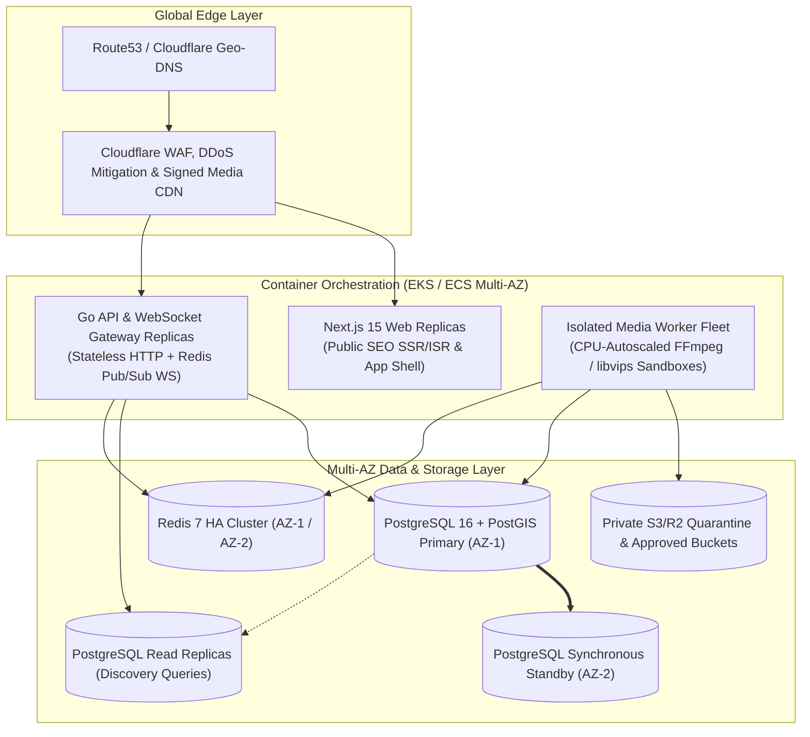

# Aura Platform — Deployment, Environments & Disaster Recovery Specification (`DEPLOYMENT.md`)

---

## 1. Environment Separation Matrix

Configuration is strictly separated by environment (`APP_ENV=local|staging|production`) via environment variables validated at process startup (`backend/internal/config`):

| Aspect | `local` (Developer Workstation) | `staging` (Pre-Production QA) | `production` (Live Commercial) |
| :--- | :--- | :--- | :--- |
| **Go API URL** | `http://localhost:8080` | `https://api.staging.auradating.com` | `https://api.auradating.com` |
| **Next.js Web URL** | `http://localhost:3000` | `https://staging.auradating.com` | `https://www.auradating.com` |
| **PostgreSQL + PostGIS** | Docker Compose `postgis/postgis:16-3.4-alpine` (`localhost:5432`) | Managed Multi-AZ Postgres 16 + PostGIS (`sslmode=verify-full`) | Managed Primary + 2 Read Replicas (`sslmode=verify-full`) |
| **Redis** | Docker Compose `redis:7.4-alpine` (`localhost:6379`) | Managed Redis 7 TLS | Managed Redis 7 Cluster (TLS + Multi-AZ Failover) |
| **Object Storage** | Local MinIO / S3-compatible mock | Isolated Staging S3/R2 Buckets | Encrypted Production S3/R2 Buckets + Signed CDN |
| **Payments** | Stripe Test Mode / Apple Sandbox | Stripe Test Mode / StoreKit Sandbox | Live Stripe / Apple App Store / Google Play |
| **Search Indexing** | Disabled (`localhost`) | Blocked (`X-Robots-Tag: noindex`) | Enabled on public routes via `robots.ts` & `sitemap.ts` |

---

## 2. Production Cloud Deployment Topology



---

## 3. Local Development Environment Runbook

### 3.1 Prerequisites
- **Go**: `1.22+` (Tested on `go1.27.1 windows/amd64`)
- **Node.js & npm**: `Node.js 20+` / `npm 10+`
- **Docker & Docker Compose**: Required to run local PostgreSQL/PostGIS and Redis containers.

### 3.2 Step-by-Step Commands

```powershell
# 1. Copy environment template
Copy-Item .env.example .env

# 2. Start PostgreSQL 16 (PostGIS 3.4) and Redis 7.4 via Docker Compose
docker compose up -d

# 3. Run versioned database migrations against local PostgreSQL
cd backend
go run ./cmd/migrate -direction=up

# 4. Start the Go Backend API Server (defaults to :8080)
go run ./cmd/api

# 5. Check Backend Liveness and Readiness probes
Invoke-RestMethod http://localhost:8080/healthz
Invoke-RestMethod http://localhost:8080/readyz

# 6. Run Go Backend Unit & Integration Tests
go test -v -race ./...

# 7. Start or Verify the Next.js Consumer Website (defaults to :3000)
cd ../web
npm install
npm run build
npm run test:seo
```

---

## 4. Monitoring, Backups & Disaster Recovery

### 4.1 Service Level Objectives (SLOs)
- **API Availability**: $99.95\%$ uptime across core endpoints.
- **Discovery Feed Latency**: $p95 < 180\text{ ms}$, $p99 < 350\text{ ms}$.
- **WebSocket Message Delivery**: $p95 < 80\text{ ms}$ end-to-end.
- **Media Processing Turnaround**: Images $p95 < 3\text{ s}$; 30-second HD Videos $p95 < 25\text{ s}$.

### 4.2 Backup & Disaster Recovery Plan
- **Database PITR**: Continuous Write-Ahead Log (WAL) shipping to encrypted cross-region object storage enabling Point-in-Time Recovery with **$\text{RPO} < 5\text{ minutes}$** and automated standby promotion with **$\text{RTO} < 30\text{ minutes}$**.
- **Ledger Integrity Audits**: Automated hourly reconciliation job verifying $\sum \text{Debits} = \sum \text{Credits}$ across all `ledger_journals` and alerting immediately on any discrepancy.
- **Quarterly DR Drills**: Automated restoration of production snapshots into an isolated recovery VPC to verify migration integrity and runbook accuracy.
