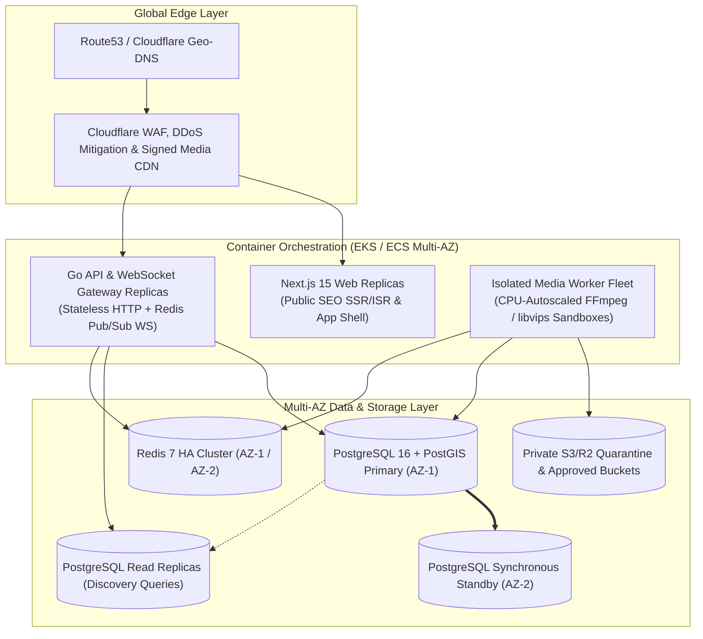

# Aura Platform — Deployment, Environments & Disaster Recovery Specification (`DEPLOYMENT.md`)

---

## 1. Environment Separation Matrix

Configuration is strictly separated by environment (`APP_ENV=local|staging|production`) via environment variables validated at process startup (`backend/internal/config`):

| Aspect | `local` (Developer Workstation) | `staging` (Pre-Production QA) | `production` (Live Commercial) |
| :--- | :--- | :--- | :--- |
| **Go API URL** | `http://localhost:8080` | `https://api.staging.auradating.com` | `https://api.auradating.com` |
| **Next.js Web URL** | `http://localhost:3000` | `https://staging.auradating.com` | `https://www.auradating.com` |
| **PostgreSQL + PostGIS** | Docker Compose `postgis/postgis:16-3.4-alpine` (`localhost:5432`) | Managed Multi-AZ Postgres 16 + PostGIS (`sslmode=verify-full`) | Managed Primary + 2 Read Replicas (`sslmode=verify-full`) |
| **Redis** | Docker Compose `redis:7.4-alpine` (`localhost:6379`) | Managed Redis 7 TLS | Managed Redis 7 Cluster (TLS + Multi-AZ Failover) |
| **Object Storage** | Local MinIO / S3-compatible mock | Isolated Staging S3/R2 Buckets | Encrypted Production S3/R2 Buckets + Signed CDN |
| **Payments** | Stripe Test Mode / Apple Sandbox | Stripe Test Mode / StoreKit Sandbox | Live Stripe / Apple App Store / Google Play |
| **Search Indexing** | Disabled (`localhost`) | Blocked (`X-Robots-Tag: noindex`) | Enabled on public routes via `robots.ts` & `sitemap.ts` |

---

## 2. Production Cloud Deployment Topology



---

## 3. Local Development Environment Runbook

### 3.1 Prerequisites
- **Go**: `1.22+` (Tested on `go1.27.1 windows/amd64`)
- **Node.js & npm**: `Node.js 20+` / `npm 10+`
- **Docker & Docker Compose**: Required to run local PostgreSQL/PostGIS and Redis containers.

### 3.2 Step-by-Step Commands

```powershell
# 1. Copy environment template
Copy-Item .env.example .env

# 2. Start PostgreSQL 16 (PostGIS 3.4) and Redis 7.4 via Docker Compose
docker compose up -d

# 3. Run versioned database migrations against local PostgreSQL
cd backend
go run ./cmd/migrate -direction=up

# 4. Start the Go Backend API Server (defaults to :8080)
go run ./cmd/api

# 5. Check Backend Liveness and Readiness probes
Invoke-RestMethod http://localhost:8080/healthz
Invoke-RestMethod http://localhost:8080/readyz

# 6. Run Go Backend Unit & Integration Tests
go test -v -race ./...

# 7. Start or Verify the Next.js Consumer Website (defaults to :3000)
cd ../web
npm install
npm run build
npm run test:seo
```

---

## 4. Monitoring, Backups & Disaster Recovery

### 4.1 Service Level Objectives (SLOs)
- **API Availability**: $99.95\%$ uptime across core endpoints.
- **Discovery Feed Latency**: $p95 < 180\text{ ms}$, $p99 < 350\text{ ms}$.
- **WebSocket Message Delivery**: $p95 < 80\text{ ms}$ end-to-end.
- **Media Processing Turnaround**: Images $p95 < 3\text{ s}$; 30-second HD Videos $p95 < 25\text{ s}$.

### 4.2 Backup & Disaster Recovery Plan
- **Database PITR**: Continuous Write-Ahead Log (WAL) shipping to encrypted cross-region object storage enabling Point-in-Time Recovery with **$\text{RPO} < 5\text{ minutes}$** and automated standby promotion with **$\text{RTO} < 30\text{ minutes}$**.
- **Ledger Integrity Audits**: Automated hourly reconciliation job verifying $\sum \text{Debits} = \sum \text{Credits}$ across all `ledger_journals` and alerting immediately on any discrepancy.
- **Quarterly DR Drills**: Automated restoration of production snapshots into an isolated recovery VPC to verify migration integrity and runbook accuracy.

---

## 5. Authentication Configuration (Google Sign-In, Sessions & Email Delivery)

Aura has no fake or simulated authentication. Every identity is either proven by a
password hash or by a Google ID token whose signature, issuer, audience and expiry
are verified server-side. The sections below list the configuration that must be
present for those flows to work. Where configuration is missing, the platform
**fails closed** rather than inventing a user, a session or a success response.

### 5.1 Google Cloud OAuth Project & Consent Screen

1. Create (or reuse) a Google Cloud project for Aura and note its **project ID**.
2. Configure **APIs & Services → OAuth consent screen**:
   - User type: `External`.
   - App name: `Aura`, plus support email, developer contact and a link to the Aura privacy policy and terms.
   - Authorized domains: the production website domain (e.g. `auradating.com`).
   - Scopes: `openid`, `email`, `profile` only. Aura never requests Google API scopes.
   - Publish the consent screen (Unverified → In production) before public release; while in "Testing", only listed test users can sign in.
3. On **APIs & Services → Credentials**, create the OAuth client IDs described below.

### 5.2 OAuth Clients and Signing Fingerprints

| Platform | Client type | Must match |
| --- | --- | --- |
| Android | Android | `android.package` = `com.aura.dating` (see `apps/mobile/app.json`) + the SHA-1 of the **actual signing keystore** |
| iOS | iOS | `ios.bundleIdentifier` = `com.aura.dating` (see `apps/mobile/app.json`) |
| Web / Expo Go | Web application | Authorized JavaScript origins + redirect URIs for the Expo proxy |

Android signing fingerprints: register one Android OAuth client per keystore. The
SHA-1 must come from the keystore that actually signs the build:

```powershell
# Debug keystore (local development only)
keytool -list -v -keystore "$env:USERPROFILE\.android\debug.keystore" -alias androiddebugkey -storepass android -keypass android

# EAS-managed release keystore (production)
eas credentials -p android
```

For Play App Signing, register **both** the upload key SHA-1 and the Google Play
App Signing key SHA-1, otherwise tokens issued by the installed production app are
rejected as "wrong audience".

### 5.3 Environment Variables

Backend (`backend/`, from `.env`):

```
GOOGLE_OAUTH_AUDIENCES=<web-client-id>,<android-client-id>,<ios-client-id>
```

- Every OAuth client ID that can obtain an ID token must be listed.
- Wildcards (`*`) are rejected in staging/production.
- With no audience configured, `POST /api/v1/auth/google` returns HTTP 503 (`google sign-in is not configured on this server`) and no account is created.

Website (`web/.env.local`):

```
AURA_API_URL=https://api.auradating.com        # required in production (503 otherwise)
NEXT_PUBLIC_API_URL=https://api.auradating.com
JWT_SIGNING_SECRET=<same 32+ byte secret as the backend>   # or AURA_SESSION_HMAC_SECRET
```

`web/src/lib/auth/session.ts` has **no** hardcoded fallback secret. If no signing
secret of at least 32 characters is present, every website request is treated as
unauthenticated and private routes redirect to `/auth/login`.

Mobile (`apps/mobile/.env`, inlined by Expo at build time):

```
EXPO_PUBLIC_APP_ENV=production
EXPO_PUBLIC_API_URL=https://api.auradating.com
EXPO_PUBLIC_GOOGLE_WEB_CLIENT_ID=<web-client-id>.apps.googleusercontent.com
EXPO_PUBLIC_GOOGLE_ANDROID_CLIENT_ID=<android-client-id>.apps.googleusercontent.com
EXPO_PUBLIC_GOOGLE_IOS_CLIENT_ID=<ios-client-id>.apps.googleusercontent.com
```

- A production build (`EXPO_PUBLIC_APP_ENV=production`, set by the `production` profile in `apps/mobile/eas.json`) **throws** instead of silently falling back to a developer LAN IP, and rejects a plaintext `http://` API URL.
- With no Google client ID configured, the Google button reports "not configured" instead of fabricating a local identity.

### 5.4 Native Build Requirement

The mobile app uses `expo-auth-session` (`Google.useIdTokenAuthRequest`) plus
`expo-web-browser`. The browser-based OpenID Connect flow it opens returns a real
Google ID token, so it does **not** require `@react-native-google-signin/google-signin`.

Caveats that are easy to get wrong:

- Google Sign-In without the Expo proxy requires a **development build / standalone build** (not Expo Go), because the OAuth redirect uses the app's custom scheme (`aura://`) registered by `app.json`.
- Configure `AURA_API_URL`/`EXPO_PUBLIC_API_URL` for the environment you are building; the backend also lists every client ID in `GOOGLE_OAUTH_AUDIENCES`.
- Google authentication never marks an account as age-verified. Adult verification remains a separate Persona-backed flow.

### 5.5 Transactional Email (OTP & Password Reset)

Verification codes and password-reset links are sent by the backend through Resend:

```
RESEND_API_KEY=re_...                 # required in staging/production
RESEND_FROM_EMAIL=Aura <security@aura.dating>
PASSWORD_RESET_URL_BASE=https://auradating.com/auth/reset-password
```

The sender domain must be verified in Resend (DKIM + SPF + DMARC records) before
delivery works. In development, omitting `RESEND_API_KEY` records a
`dev_notification_sink_delivered_verification_otp` log line (with the OTP **length**
only, never the code). In staging/production an unconfigured provider returns
`ErrTransactionalEmailUnconfigured` instead of claiming delivery succeeded, and no
plaintext password, OTP or reset token is ever logged.

