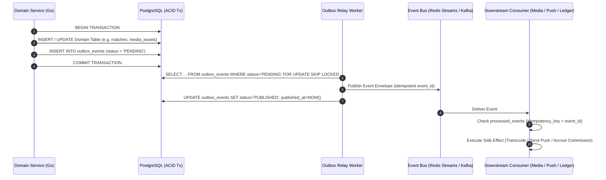

# Aura Platform — Asynchronous Event Architecture & Catalog (`EVENTS.md`)

**Pattern**: Transactional Outbox (`outbox_events`) + Pluggable Event Bus (`internal/events`)  
**Phase 01 Transport**: PostgreSQL Outbox Poller + Redis Streams/PubSub (Zero external broker overhead in local dev)  
**Production High-Scale Transport**: Apache Kafka / Redpanda adapter implementing the identical `events.Publisher` & `events.Subscriber` Go interfaces.

---

## 1. Transactional Outbox & Delivery Architecture

To prevent dual-write inconsistencies (e.g., saving a match or payment in PostgreSQL but failing to publish the event to a broker), all domain events are written to the `outbox_events` table **inside the same ACID database transaction** as the domain state change.



---

## 2. Standard Event Envelope

Every domain event conforms to the CloudEvents-aligned JSON envelope defined in `backend/internal/events`:

```json
{
  "event_id": "019283a4-7c9b-7000-8000-1a2b3c4d5e6f",
  "event_type": "media.upload.completed.v1",
  "aggregate_type": "media_asset",
  "aggregate_id": "550e8400-e29b-41d4-a716-446655440000",
  "occurred_at": "2026-10-13T02:00:00Z",
  "trace_id": "9b1deb4d-3b7d-4bad-9bdd-2b0d7b3dcb6d",
  "version": 1,
  "payload": {}
}
```

---

## 3. Domain Event Catalog

| Event Type | Producer Module | Consumer Module(s) | Purpose & Side Effects |
| :--- | :--- | :--- | :--- |
| `identity.user.registered.v1` | `identity` | `affiliate`, `analytics`, `messaging` | Binds referral attribution code if present; triggers welcome verification email. |
| `identity.user.deleted.v1` | `identity` | `media`, `messaging`, `discovery` | Schedules asynchronous S3/R2 purge of all user media and anonymizes chat history (GDPR erasure). |
| `media.upload.completed.v1` | `media` | `media-worker` | Triggers magic-byte validation, EXIF/GPS stripping, CSAM/NSFW scan, and WebP/AVIF or FFmpeg HLS transcoding. |
| `media.processing.succeeded.v1` | `media-worker` | `profile`, `messaging` | Marks `media_assets.status = 'READY'`; notifies connected client via WebSocket (`media.ready`). |
| `media.processing.rejected.v1` | `media-worker` | `moderation`, `messaging` | Quarantines flagged upload, notifies user of policy violation, or opens Trust & Safety case. |
| `matching.mutual_match.created.v1` | `matching` | `messaging`, `notifications` | Creates conversation thread; dispatches real-time WebSocket frame and discrete APNs/FCM push notification. |
| `matching.super_spark.sent.v1` | `matching` | `notifications` | Dispatches priority push notification with intro note preview. |
| `messaging.message.sent.v1` | `messaging` | `ws-gateway`, `notifications` | Broadcasts message over Redis Pub/Sub to recipient's active WebSocket node or triggers offline push notification. |
| `billing.subscription.activated.v1` | `billing` | `entitlements`, `affiliate` | Grants `Aura Plus` / `Aura Black` entitlements; triggers initial affiliate commission accrual if attributed. |
| `billing.subscription.renewed.v1` | `billing` | `entitlements`, `affiliate` | Extends entitlement period; triggers recurring affiliate commission accrual if within `max_recurring_months`. |
| `billing.payment.refunded.v1` | `billing` | `entitlements`, `affiliate` | Revokes paid entitlements immediately; posts reversing clawback journal entry in affiliate commission ledger. |
| `affiliate.commission.matured.v1` | `affiliate` | `affiliate-ledger` | Moves commission from `PENDING_CLEARANCE` to `AVAILABLE_FOR_PAYOUT` after the 30-day escrow window expires. |
| `moderation.report.submitted.v1` | `moderation` | `trust-safety` | Snapshots reported profile and recent chat messages; prioritizes case by severity score. |

---

## 4. Retry, Backoff & Dead-Letter Policy

- **Retry Schedule**: Exponential backoff with full jitter: $\text{delay} = \min(3600\text{s}, 2^{\text{attempt}} \times 5\text{s})$.
- **Max Attempts**: `10` attempts.
- **Dead-Letter Queue (DLQ)**: Events failing after 10 attempts transition to `status = 'FAILED'` (`dead_letter_events`), firing a Prometheus alert (`aura_outbox_dead_letter_total > 0`) for operator inspection and replay.
