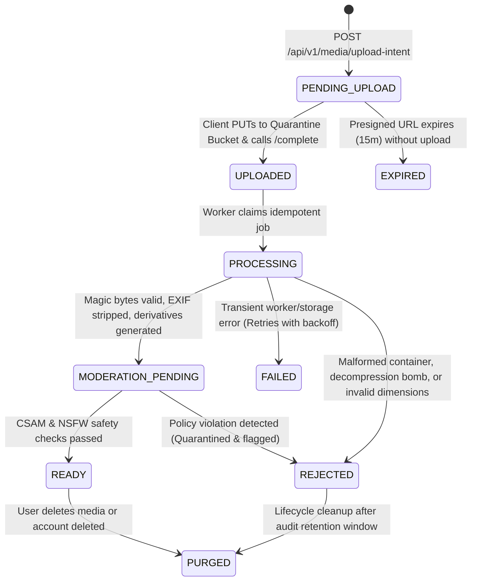

# Aura Platform — Mandatory Media Processing, Optimization & Safety Specification (`MEDIA_SPEC.md`)

> [!IMPORTANT]
> **PERMANENT PRODUCT REQUIREMENT**: Whenever a user uploads an image or video through the iOS app, Android app, or website, the platform **must** automatically validate, sanitize, moderate, transcode, and optimize that media asynchronously before it can ever be published or viewed by any other user.

---

## 1. Media Asset Lifecycle & State Machine

No user-uploaded file is ever served directly from its upload location. Every media asset transitions through a deterministic, observable state machine:

**Visibility Invariant**: Queries for profile photos, verification selfies, and chat attachments strictly filter on `status = 'READY' AND moderation_verdict = 'APPROVED'`. Unprocessed or moderation-pending media is never exposed.

---

## 2. Image Processing Pipeline Specification

### 2.1 Validation & Limits
- **Allowed Input Formats**: `image/jpeg`, `image/png`, `image/webp`, `image/heic`, `image/heif`, `image/avif`.
- **Magic-Byte Verification**: Worker inspects file header signatures (`FF D8 FF` for JPEG, `89 50 4E 47` for PNG, `RIFF....WEBP` for WebP, `ftypheic`/`ftypavif` for HEIC/AVIF) rather than trusting client-supplied `Content-Type` or file extension.
- **File Size Limits**: Configurable per purpose; default max `15 MB` (`15,728,640 bytes`).
- **Dimension Limits**:
  - Minimum dimensions: `400 x 400 px` (for profile gallery photos).
  - Maximum dimensions: `8192 x 8192 px` ( (`67 MP`) hard ceiling checked via image header reader before pixel buffer allocation to prevent decompression bombs).

### 2.2 EXIF & GPS Metadata Stripping
- All image decoding/re-encoding strips **100% of ancillary metadata segments**:
  - `EXIF` (Camera model, serial number, capture timestamp, **GPS Latitude/Longitude/Altitude**).
  - `IPTC` & `XMP` creator/location tags.
  - Embedded thumbnails and comment blocks.
- Color profiles are normalized to standard `sRGB` so colors render accurately without carrying custom ICC profile metadata fingerprints.
- The database sets `media_assets.exif_stripped = TRUE` only after verifying zero EXIF tags remain on output derivatives.

### 2.3 Resizing, Compression & Responsive Derivatives
Every approved image generates 5 immutable derivatives stored in the private approved bucket:

| Variant Code | Format | Target Dimensions | Fit / Crop Mode | Quality Setting | Primary Use Case |
| :--- | :--- | :--- | :--- | :--- | :--- |
| **`THUMB_WEBP`** | `image/webp` | `160 x 160 px` | Center-crop square | `q = 78` | Chat avatars, match list icons |
| **`CARD_WEBP`** | `image/webp` | `640 x 800 px` (4:5) | Smart aspect fit/crop | `q = 82` | Discovery swipe cards (WebP fallback) |
| **`CARD_AVIF`** | `image/avif` | `640 x 800 px` (4:5) | Smart aspect fit/crop | `q = 75` | Discovery swipe cards (Primary modern) |
| **`FULL_WEBP`** | `image/webp` | Max `1280 x 1600 px` | Preserve aspect ratio | `q = 85` | Expanded full-screen profile view |
| **`FULL_AVIF`** | `image/avif` | Max `1280 x 1600 px` | Preserve aspect ratio | `q = 78` | Expanded full-screen profile view |

---

## 3. Video Processing Pipeline Specification

### 3.1 Validation & Limits
- **Allowed Input Containers**: `video/mp4`, `video/quicktime` (`.mov`), `video/webm`.
- **Allowed Input Codecs**: `H.264 (AVC)`, `H.265 (HEVC)`, `VP8`, `VP9`, `AV1`; audio `AAC`, `MP3`, `Opus`.
- **Configurable Limits**:
  - Max File Size: `100 MB` (`104,857,600 bytes`).
  - Duration: `3.0 seconds` minimum to `30.0 seconds` maximum for profile loops; up to `60.0 seconds` for chat video clips.
  - Max Input Resolution: `3840 x 2160` (`4K UHD`), max frame rate `60 fps`.
- **Pre-Flight `ffprobe` Inspection**: Inspects stream count, duration, codec, and packet integrity under a 5-second timeout before launching `ffmpeg`. Rejects files with data streams, subtitle exploits, or external reference tracks.

### 3.2 FFmpeg Transcoding, Compression & Adaptive Streaming
Videos are transcoded asynchronously by isolated worker nodes using `ffmpeg` with `-map_metadata -1` (stripping all QuickTime/MP4 GPS location tags such as `com.apple.quicktime.location.ISO6709`):

| Derivative Code | Format / Codec | Resolution | Max Bitrate | Audio | Purpose |
| :--- | :--- | :--- | :--- | :--- | :--- |
| **`HLS_480P`** | HLS (`.m3u8` + `.m4s`, H.264 Main) | `540 x 960` (9:16) | `1.2 Mbps` | AAC 96 kbps | Mobile cellular / low-bandwidth stream |
| **`HLS_720P`** | HLS (`.m3u8` + `.m4s`, H.264 High) | `720 x 1280` (9:16) | `2.5 Mbps` | AAC 128 kbps | Standard HD playback |
| **`HLS_1080P`** | HLS (`.m3u8` + `.m4s`, H.264 High) | `1080 x 1920` (9:16) | `4.5 Mbps` | AAC 128 kbps | High-definition Wi-Fi / 5G playback |
| **`MP4_720P`** | Progressive MP4 (`faststart`) | `720 x 1280` | `2.2 Mbps` | AAC 128 kbps | Universal fallback for legacy clients |
| **`VIDEO_POSTER`**| `image/webp` + `image/avif` | `640 x 1136` | — | None | Instant first-frame poster thumbnail |

---

## 4. Safety, Moderation & Storage Lifecycle Policies

### 4.1 Automated Moderation Gate
1. **CSAM Hash Matching**: Perceptual hash (PhotoDNA / PDQ / TMK) checked against known illegal content databases. Any positive match immediately locks the account, preserves forensic evidence in an encrypted legal-hold vault, and triggers mandatory reporting protocols.
2. **NSFW & Policy Classifier**: Evaluates nudity, explicit sexual content, weapons/violence, and hate symbols according to placement rules (public profile photos prohibit explicit nudity; borderline scores route to `MANUAL_REVIEW` in the Trust & Safety console).

### 4.2 Private Storage, Signed CDN & Retention Lifecycle
1. **Quarantine Bucket (`aura-media-quarantine`)**:
   - Strictly private (`BlockPublicAccess = true`).
   - Raw original files are retained for **7 days** after successful derivative generation (`original_purge_after = NOW() + INTERVAL '7 days'`) to allow re-transcoding if needed, then automatically deleted via S3/R2 Object Lifecycle rules.
   - Abandoned `PENDING_UPLOAD` objects are purged after **24 hours**.
2. **Approved Derivatives Bucket (`aura-media-approved`)**:
   - Strictly private (`BlockPublicAccess = true`).
   - Served exclusively through the CDN using **Cloudflare / CloudFront Signed URLs** (`exp = 1 hour`) generated dynamically by the Go backend only for authorized viewers.
3. **Idempotency & Failure Recovery**:
   - Every processing job carries a deterministic `idempotency_key` (`sha256(media_asset_id + pipeline_version)`).
   - Worker crashes or timeouts are recovered by the durable job visibility timeout (`3 minutes`), retrying up to `5` times with exponential backoff before transitioning to `FAILED` and cleaning up partial S3 objects.
