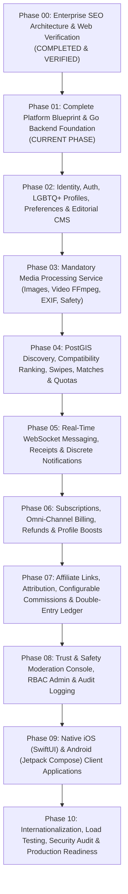

# Aura LGBTQ+ Dating Platform — Master Engineering Execution Plan (`PLAN.md`)

This master plan governs the multi-phase development of the complete commercial Aura platform. Each phase builds incrementally on verified engineering foundations without replacing production code with mocks.

---

## Phase Roadmap Overview

---

## Detailed Phase Breakdown

### Phase 00 — Enterprise SEO Architecture & Consumer Web Foundation (`VERIFIED`)
- Next.js 15 App Router public discovery pages (`/`, `/dating`, `/gay-dating`, `/lesbian-dating`, `/bisexual-dating`, `/queer-dating`, `/safety`, `/features`, `/pricing`, `/download`, `/legal/*`).
- Dynamic `robots.ts`, `sitemap.ts`, canonical URLs, `hreflang` metadata, Schema.org JSON-LD, and Edge Middleware privacy boundaries.
- Verified with 37 automated Playwright SEO acceptance tests.

### Phase 01 — Complete Platform Blueprint + Go Engineering Foundation (`CURRENT`)
- Complete root-level specifications (`PRODUCT_SPEC.md`, `ARCHITECTURE.md`, `DATABASE.md`, `API_CONTRACTS.md`, `EVENTS.md`, `SECURITY.md`, `BILLING_SPEC.md`, `AFFILIATE_SPEC.md`, `MEDIA_SPEC.md`, `DEPLOYMENT.md`, `PLAN.md`, `TASKS.md`).
- Go backend foundation (`backend/`) with structured config validation, `slog` logging, request ID middleware, panic recovery, standardized API error responses, graceful shutdown, `/healthz` and `/readyz` probes, PostgreSQL (`pgxpool`) + PostGIS connection management, versioned SQL migration runner (`cmd/migrate`), Redis client integration, transactional outbox event interfaces, Docker Compose environment, and CI quality checks.

### Phase 02 — Identity, Authentication, LGBTQ+ Profiles & Editorial CMS
- Argon2id credential authentication, OAuth 2.0 (Apple/Google), SMS OTP verification, and rotating refresh tokens in PostgreSQL + Redis.
- Complete LGBTQ+ gender identity, sexual orientation, pronoun, relationship-intent, and attribute-visibility CRUD APIs.
- Wire Next.js member routes (`/app/*`, `/auth/login`) to real Go Identity Service endpoints.
- Implement database-backed Editorial CMS workflow (`DRAFT` $\rightarrow$ `IN_REVIEW` $\rightarrow$ `PUBLISHED`) and curated city guides.

### Phase 03 — Mandatory Media Processing & Safety Pipeline
- Implement `internal/media` upload intent & presigned quarantine URLs.
- Implement asynchronous image worker (magic-byte check, decompression bomb guard, 100% EXIF/GPS stripping, `WebP` & `AVIF` responsive variants).
- Implement asynchronous FFmpeg video worker (container validation, metadata stripping, `480p`/`720p`/`1080p` HLS adaptive streaming, poster generation).
- Integrate CSAM/NSFW moderation gate and signed CDN URL delivery.

### Phase 04 — PostGIS Discovery, Ranking, Swipes, Matching & Quotas
- PostGIS `GEOGRAPHY(Point, 4326)` spatial indexing, anti-trilateration distance bucketing, and Global Passport overrides.
- Multi-stage compatibility ranking engine.
- `LIKE`, `PASS`, `SUPER_SPARK`, and `REWIND` transactions, atomic mutual-match creation, daily entitlement quotas, and match reward milestones.

### Phase 05 — Real-Time Chat, WebSocket Gateway & Notifications
- Horizontal WebSocket gateway (`internal/messaging`) backed by Redis Pub/Sub.
- Message persistence, idempotency, typing indicators, read receipts, in-chat media attachments, and discrete push notifications (APNs / FCM).

### Phase 06 — Subscriptions, Billing, Refunds & Profile Boosts
- Stripe Checkout/Billing, Apple App Store Server API v2, and Google Play Billing v7 integration.
- Cryptographically verified idempotent webhook processors.
- Entitlement state machine, consumable Profile Boosts, and automated refund/chargeback entitlement revocation.

### Phase 07 — Affiliate Attribution, Configurable Commissions & Double-Entry Ledger
- Referral link click tracking (`/r/[code]`), 30-day attribution binding, and anti-self-referral fraud checks.
- Configurable CPA / Rev-Share / Hybrid and recurring renewal commission rules engine.
- Immutable double-entry accounting ledger (`ledger_accounts`, `ledger_journals`, `ledger_entries`), 30-day escrow maturation worker, automated refund clawbacks, and Stripe Connect partner payouts.

### Phase 08 — Admin Panel, Trust & Safety Moderation & Reporting
- User blocking and in-app abuse/harassment reporting with immutable chat/media evidence snapshots.
- RBAC-protected Trust & Safety moderation queue, selfie verification review console, affiliate management UI, and append-only admin audit logs.

### Phase 09 — Native iOS & Android Applications
- iOS (SwiftUI) and Android (Kotlin / Jetpack Compose) native client applications implementing onboarding, discovery cards, chunked media upload, WebSocket chat, StoreKit 2 / Play Billing, and Discrete App Icon / Biometric Lock controls.

### Phase 10 — International Expansion, Load Testing & Launch Readiness
- Multi-locale route deployment (`/en-gb/`, `/de-de/`, `/fr-fr/`) and legal clearance enforcement.
- k6 load testing, chaos/failover verification, security penetration testing, and production cutover checklist.
