# Phase 00: Enterprise-Grade SEO Architecture & Implementation Plan

## Overview

This document defines the comprehensive **Phase 00 Architecture & Implementation Plan** for incorporating Enterprise-Grade SEO as a foundational pillar of the consumer LGBTQ+ dating platform.

---

## 1. Requirement Traceability Matrix

| Requirement Section | Architectural Solution | Documentation Link |
| :--- | :--- | :--- |
| **1. Technical SEO** | Next.js App Router SSG/ISR, dynamic Metadata API, canonical normalization, sitemap indexes, structured data, mobile performance | [`technical-seo-specification.md`](file:///C:/Users/ACER/.gemini/antigravity/scratch/lgbtq-dating-platform/docs/architecture/technical-seo-specification.md) |
| **2. Public SEO Pages** | Demographic hubs (`/gay-dating`, `/lesbian-dating`, etc.), curated high-value city pages, safety & privacy guides, editorial CMS workflow | [`technical-seo-specification.md`](file:///C:/Users/ACER/.gemini/antigravity/scratch/lgbtq-dating-platform/docs/architecture/technical-seo-specification.md#2-public-seo-pages--taxonomy) |
| **3. User Privacy Protection** | Multi-layer privacy shielding, middleware `X-Robots-Tag: noindex`, `Cache-Control: private, no-store`, zero private profile leakage, explicit UGC consent | [`privacy-preserving-seo-and-security.md`](file:///C:/Users/ACER/.gemini/antigravity/scratch/lgbtq-dating-platform/docs/architecture/privacy-preserving-seo-and-security.md) |
| **4. International SEO** | Multi-market directory taxonomy, bidirectional hreflang, strict UAE legal clearance gating & safety fallback | [`international-seo-and-market-clearance-matrix.md`](file:///C:/Users/ACER/.gemini/antigravity/scratch/lgbtq-dating-platform/docs/architecture/international-seo-and-market-clearance-matrix.md) |
| **5. Core Web Vitals** | Mobile-first CWV budgets (LCP < 2s, INP < 150ms, CLS < 0.05), zero-CLS fonts via `next/font`, modern WebP/AVIF images, Lighthouse CI | [`core-web-vitals-performance-budget.md`](file:///C:/Users/ACER/.gemini/antigravity/scratch/lgbtq-dating-platform/docs/architecture/core-web-vitals-performance-budget.md) |
| **6. SEO Analytics & CI/CD** | GSC & Bing IndexNow integration, privacy-safe UTM attribution, automated Playwright regression suite, Lighthouse CI gates | [`seo-analytics-monitoring-and-ci-cd.md`](file:///C:/Users/ACER/.gemini/antigravity/scratch/lgbtq-dating-platform/docs/architecture/seo-analytics-monitoring-and-ci-cd.md) |
| **7. Acceptance Criteria** | 10 concrete acceptance criteria with automated test harness & sign-off protocols | Section 3 below |

---

## 2. Implementation Roadmap by Phase

```mermaid
flowchart TD
    subgraph Phase00["Phase 00: Architectural Blueprint & SEO Foundation"]
        P0_1["Define SEO Taxonomy & Architecture"]
        P0_2["Establish Route Privacy Boundaries"]
        P0_3["Design International & UAE Legal Gate"]
        P0_4["Define CWV Performance Budgets"]
    end

    subgraph Phase01["Phase 01: Core Web Engine & Privacy Firewall"]
        P1_1["Next.js App Router Setup & Middleware"]
        P1_2["X-Robots-Tag & Cache Suppression Engine"]
        P1_3["Dynamic Metadata & Canonical Generators"]
        P1_4["Dynamic robots.ts & sitemap.ts"]
    end

    subgraph Phase02["Phase 02: Public Landing Pages & CMS Workflow"]
        P2_1["Demographic Intent Hubs (/gay-dating, /lesbian-dating, etc.)"]
        P2_2["Curated Local City Guides Engine"]
        P2_3["Safety & Privacy Knowledge Base"]
        P2_4["Headless CMS Draft-Review-Publish Flow"]
    end

    subgraph Phase03["Phase 03: Structured Data & International Hreflang"]
        P3_1["Schema.org JSON-LD Generators (Org, FAQ, Article, App)"]
        P3_2["Multi-region Hreflang & Translation Pipeline"]
        P3_3["UAE Legal Safety Routing Enforcement"]
    end

    subgraph Phase04["Phase 04: Analytics, CI/CD & Final Verification"]
        P4_1["GSC, Bing & IndexNow Integration"]
        P4_2["Privacy-Preserving Attribution Tracking"]
        P4_3["Playwright & Lighthouse CI Automated Gates"]
        P4_4["Acceptance Criteria Verification Sign-off"]
    end

    Phase00 --> Phase01
    Phase01 --> Phase02
    Phase02 --> Phase03
    Phase03 --> Phase04
```

---

## 3. The 10 SEO Acceptance Criteria Verification Protocols

### Criterion 1: Public landing pages return useful content in crawlable HTML
- **Verification Protocol**: Execute `curl -A "Googlebot" -s https://[domain]/dating | grep -i "<h1>"`
- **Verification Rule**: The raw HTML payload must contain all headings, body copy, and internal links without requiring client-side JavaScript execution.
- **Automated Test**: Playwright test `tests/seo.spec.ts` executes with JavaScript disabled (`javaScriptEnabled: false`) and validates full DOM accessibility.

### Criterion 2: Every intended indexable page has appropriate metadata and a canonical URL
- **Verification Protocol**: Automated audit parses all sitemap URLs.
- **Verification Rule**: Each page contains `<title>` between 30 and 60 characters, `<meta name="description">` between 120 and 160 characters, and an absolute `<link rel="canonical">` matching the request URI.

### Criterion 3: Sitemaps contain valid, canonical, indexable URLs
- **Verification Protocol**: Sitemaps validated against XML schema.
- **Verification Rule**: No 301 redirects, no 404s, no private `/app/*` routes, and no `noindex` pages appear in any sub-sitemap.

### Criterion 4: robots.txt and robots directives are correct
- **Verification Protocol**: Validate with Google robots.txt tester tool and automated regex parser.
- **Verification Rule**: Public paths are allowed; `/app/`, `/api/`, `/messages/`, `/matches/`, `/profile/`, `/auth/` are disallowed; sitemap index is explicitly linked.

### Criterion 5: Private routes do not reveal protected information
- **Verification Protocol**: Automated crawler fetches `/app/profile/1`, `/messages/thread/1`, `/api/matches` without cookies.
- **Verification Rule**: Server returns immediate 302/401 redirect; response headers contain `X-Robots-Tag: noindex, nofollow, noarchive`; zero user profile data or PII is leaked in the response payload.

### Criterion 6: Structured data matches visible page content
- **Verification Protocol**: Schema.org JSON-LD validator & Google Rich Results Test API.
- **Verification Rule**: JSON-LD scripts validate with 0 errors. All entities (Organization, FAQPage, Article, SoftwareApplication) accurately reflect visible page text.

### Criterion 7: International annotations and localized URLs are consistent
- **Verification Protocol**: Bidirectional hreflang crawler.
- **Verification Rule**: If page A references page B in `hreflang="en-GB"`, page B must reciprocally reference page A in `hreflang="en-US"`, and both declare `x-default`.

### Criterion 8: Internal links work and no important public page is orphaned
- **Verification Protocol**: Site-wide recursive crawl.
- **Verification Rule**: Zero broken internal links (404/500). All core demographic hubs, safety guides, and city landers are reachable within <= 3 clicks from root.

### Criterion 9: Performance and accessibility checks run automatically
- **Verification Protocol**: Lighthouse CI automated run on production build.
- **Verification Rule**: Performance >= 95, Accessibility >= 98, Best Practices = 100, SEO = 100 on simulated mobile devices. LCP <= 2.0s, CLS <= 0.05.

### Criterion 10: Indexability, analytics, and deployment configuration are documented
- **Verification Protocol**: Comprehensive engineering documentation and runbooks provided in `/docs/architecture/` with step-by-step GSC/Bing setup.

---

## 4. Recorded Architectural Defaults (Deferred to Phase 02)

To avoid blocking foundational engineering, the following defaults are established and deferred for final customization during Phase 02:

1. **Editorial CMS Provider & Workflow Default**:
   - **Default Selection**: Internal database-backed editorial workflow (PostgreSQL + Prisma/Drizzle schema) with clean repository interfaces allowing plug-and-play integration with Sanity or Contentful if external editorial tooling is later required.
   - **Supported States**: `DRAFT` -> `IN_REVIEW` -> `PUBLISHED` -> `ARCHIVED` (with automatic `revalidatePath` webhook trigger).

2. **Initial Curated Location Pages Default**:
   - **Default Selection**: Initial launch set restricted to 10 vetted Tier-1 metropolitan hubs across legally cleared jurisdictions (New York City, San Francisco, Los Angeles, Chicago, London, Manchester, Berlin, Paris, Toronto, Sydney).
   - **Governance**: Location routes remain unindexed and unpublished until local LGBTQ+ community resources, crisis helplines, and legal context are populated.
   - **Regional Restrictions**: Disabled by default (`enableRegionalRestrictions: false`) until product, legal, and safety reviews are formally approved.

